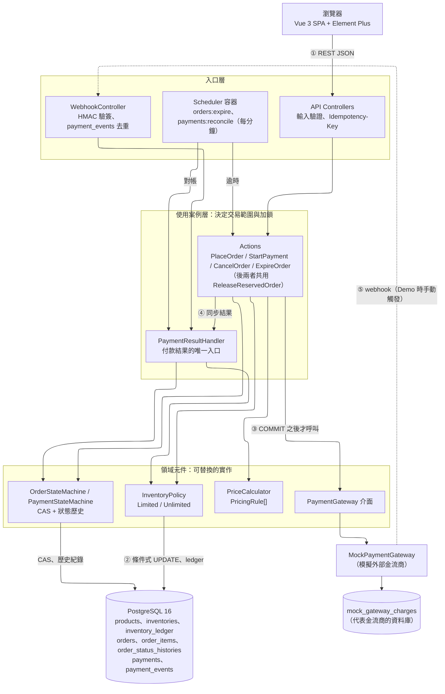
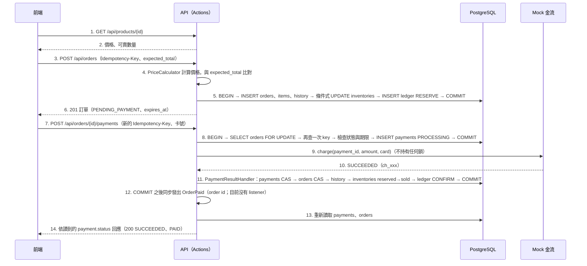
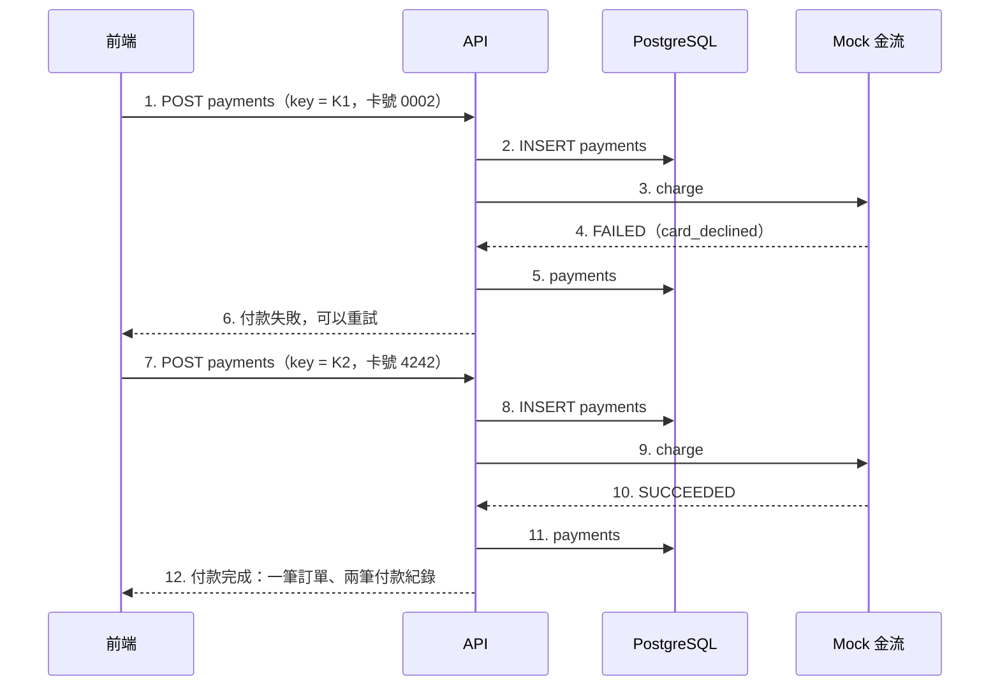
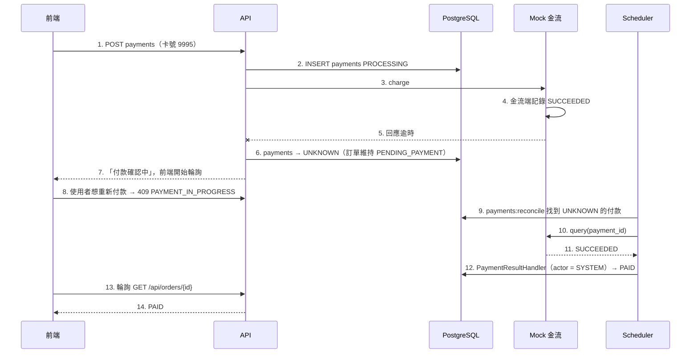
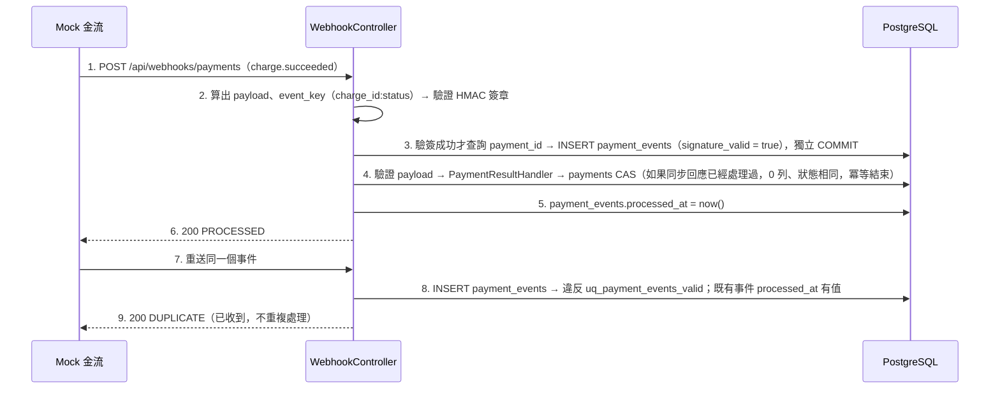

# 系統架構

> 資料表見 [database-schema.md](./database-schema.md)，交易步驟見 [checkout-flow.md](./checkout-flow.md)，每個決策的取捨見 [trade-offs.md](./trade-offs.md)。

## 一、架構總覽



**分四層，依賴只往下**：入口層只負責「誰觸發」，使用案例層決定交易範圍，領域元件是可以替換的實作，資料層是唯一的 source of truth。

**三條付款結果的路徑（④ 同步回應、⑤ webhook、Scheduler 對帳）全部進到 `PaymentResultHandler`。** 狀態轉換的邏輯只寫一次，重複送達的結果則由 CAS 吸收；互相矛盾的結果（CAS 0 列但狀態不同）由 handler 標記需要人工處理（[checkout-flow.md](./checkout-flow.md) §4.2）。訂單轉成 `PAID` 時，handler 發出 domain event `OrderPaid`（COMMIT 之後同步發出，§二）。

### 元件職責

| 元件 | 職責 | 不負責 |
|---|---|---|
| Controllers | HTTP 輸入驗證、Idempotency-Key 處理、轉換回應格式 | 商業邏輯 |
| Actions | 一個使用案例一個類別；決定交易的範圍與加鎖 | 計價規則、庫存規則的細節 |
| `PriceCalculator` | 依序執行 `PricingRule`，產出 `PriceQuote` | 寫入資料庫 |
| `InventoryPolicy` | 保留、確認、釋放庫存（包含寫入 ledger） | 判斷訂單狀態 |
| `OrderStateMachine`／`PaymentStateMachine` | 執行 CAS 並寫入狀態歷史 | 決定什麼時候轉換 |
| `PaymentResultHandler` | 把付款結果轉成付款、訂單、庫存的狀態連動；CAS 0 列時判斷冪等或衝突；寫入需要人工處理的標記；訂單 CAS 成功時發出 `OrderPaid` | 呼叫金流；寄信等付款後的後續動作（交給 `OrderPaid` 的 listener） |
| `PaymentGateway` | 和金流溝通：`charge()`、`query()` | 寫入我方的資料表 |
| Scheduler | 定期觸發逾時任務和對帳任務 | 自己實作商業邏輯（一律呼叫 Actions 和 Handler） |

### 版本

| 項目 | 版本 |
|---|---|
| PHP | 8.5（以 `docker/app/Dockerfile` 為準，需符合 Laravel 13 的最低需求） |
| Laravel | 13 |
| 測試 | Pest（與 Laravel 13 相容的最新版） |
| 前端 | Vue 3、Vue Router、Element Plus、axios，皆為最新穩定版 |
| 建置 | Vite 與 `laravel-vite-plugin`、`@vitejs/plugin-vue`，皆為最新穩定版 |
| 資料庫 | PostgreSQL 16 |

### 容器

| 容器 | 內容 | 數量 |
|---|---|---|
| `app` | Nginx + php-fpm（`pm.max_children = 40`、`request_terminate_timeout = ${PHP_FPM_REQUEST_TERMINATE_TIMEOUT}`，預設 30 秒），同時提供 Vue SPA 的靜態檔和 `/api`；啟動時自動 `migrate`，`RUN_SEED=true` 且 `products` 是空的時候執行 seed；`backend/.env` 的 `MOCK_GATEWAY_WEBHOOK_SECRET` 是空的時候，entrypoint 產生隨機的 32 bytes 寫入（已有值則保留）。PHP 使用 production `php.ini`：`zend.exception_ignore_args=On`（stack trace 不含參數，卡號不會進 log，INV-13）、`display_errors=Off`、`expose_php=Off`；Nginx 設 `server_tokens off`，並對所有回應加上 `Referrer-Policy: no-referrer`（訂單 URL 含 UUID，它就是查詢憑證，[trade-offs.md](./trade-offs.md) #13） | 1 |
| `scheduler` | 同一個 image，執行 `php artisan schedule:work` | **1**（多個實例會重複執行；任務也加上 `withoutOverlapping()`） |
| `postgres` | PostgreSQL 16（`max_connections = 300`） | 1 |
| `node` | 一次性的前端建置：`npm ci && npm run build`，輸出到 `backend/public/build`（bind mount）後就結束（`restart: "no"`）。app 不依賴它；修改前端後執行 `docker compose run --rm node` 重新建置 | 執行完即結束 |

`docker compose up` 就能啟動全部服務。沒有 Redis，也沒有 Queue worker（理由見 [trade-offs.md](./trade-offs.md) #9、#11）。執行期間的服務只有 `app`、`scheduler`、`postgres`；`node` 只負責建置，不保存任何資料（[trade-offs.md](./trade-offs.md) #32）。

`pm.max_children` 至少要 30：併發測試會同時送出 20 個請求，而 `/api/demo/payments/{id}/webhook` 處理時會再對 app 自己送一個 HTTP 請求，佔用兩個 worker。

`request_terminate_timeout` 由環境變數 `PHP_FPM_REQUEST_TERMINATE_TIMEOUT` 設定（`docker/app/php-fpm-pool.conf` 寫成 `request_terminate_timeout = ${PHP_FPM_REQUEST_TERMINATE_TIMEOUT}`，沒有單位時就是秒），`config/checkout.php` 讀同一個變數，啟動檢查才能驗證它和對帳安全等待時間的關係（[checkout-flow.md](./checkout-flow.md) §二、[trade-offs.md](./trade-offs.md) #37）。它只作用在 php-fpm（HTTP 請求）；scheduler 的 artisan 指令是 CLI，不受影響，指令內也不會呼叫 `charge()`。

### 資料庫連線數

PostgreSQL 一個連線就是一個 process。目前的用量：

| 來源 | 最多連線數 | 說明 |
|---|---|---|
| `app` 容器 | 40 | 每個 php-fpm worker 處理請求時一條（Laravel 不用 persistent connection）；上限就是 `pm.max_children` |
| `scheduler` 容器 | 約 3 | `schedule:work` 本身，加上 `orders:expire`、`payments:reconcile` 兩個子程序 |
| `pest --parallel` | 每個 process 1 條（預設等於 CPU 核心數），加上 `concurrency` group 的 `pgsql_app` 連線 | 併發測試打到 app 的請求算在 app 的 40 條內 |
| 保留給 superuser | 3 | PostgreSQL 預設的 `superuser_reserved_connections` |

`max_connections = 300` 時，約 **(300 − 3 − 3 − 測試用量) ÷ 40 ≈ 7 個 app 容器**就會用完。這次只有一個 app 容器（requirements.md §三：不做 Load Balancer、讀寫分離），餘裕約 250 條。

**什麼時候需要 PgBouncer**：app 容器數 × `pm.max_children` 接近 `max_connections` 時（例如為了 10 倍流量擴成 6 個以上的 app 容器）。不在這次的範圍內，引入前要由使用者決定。屆時要注意 transaction pooling 的限制：

- **`FOR UPDATE` 不受影響**：鎖只存在於 transaction 內，transaction pooling 保證一個 transaction 從頭到尾使用同一條 server connection。本設計所有的鎖（訂單 `FOR UPDATE`、條件式 UPDATE 的 row lock）都在 transaction 內，沒有 session 層級的 advisory lock
- **會壞的是 session 層級的狀態**：`pdo_pgsql` 預設使用具名的 server-side prepared statement（需要 PgBouncer 1.21 以上的 `max_prepared_statements`，或把 PDO 改成 `ATTR_EMULATE_PREPARES`）；Laravel 的 pgsql connector 在連線時執行的 `SET`（時區、`search_path`）會套到別人的連線上，要改成在資料庫或 role 層級設定
- `withoutOverlapping()` 的排程鎖與 API 限流的計數器都存在 `CACHE_STORE=file`，不經過資料庫，不受影響

### 多個 worktree 平行開發

每個 worktree 裡的 compose 目錄都叫 `02-easier-checkout`，所以要讓每個 worktree 有自己的 project name。設定方式是先執行一次 `bin/worktree-env.sh`：

```bash
cd 02-easier-checkout
bin/worktree-env.sh        # 產生 .env：COMPOSE_PROJECT_NAME=zeczec02-<worktree>、APP_PORT、DB_PORT
docker compose up -d       # 容器、network、volume、image 都會加上 project name 當前綴
```

| 資源 | 怎麼隔離 |
|---|---|
| 容器、network、`pgdata` volume、image | 依 `COMPOSE_PROJECT_NAME` 自動加前綴（所以 compose 檔裡不能寫 `container_name`） |
| Host port | `APP_PORT`（8100–8199）、`DB_PORT`（5500–5599）：依 worktree 名稱算出起點，避開正在使用的 port 和其他 worktree 已登記的 port |
| 資料庫 | 每個 worktree 有自己的 PostgreSQL；`checkout` 給 demo 用，`checkout_test` 給 Pest 用 |
| Composer 快取 | 刻意共用（`zeczec02-composer-cache`），加快安裝速度 |

測試指令：

```bash
docker compose exec app ./vendor/bin/pest --parallel               # 會自動建立 checkout_test_test_1、_2 …
docker compose exec app ./vendor/bin/pest --group=concurrency      # 對 CONCURRENCY_BASE_URL（http://app）打真正的 HTTP 請求
```

compose 會把 `DB_*` 用真正的環境變數注入容器，這些值會出現在 `$_SERVER`；Laravel 的 env repository 先讀 `$_SERVER`，而 phpunit 的 `<env force="true">` 只覆蓋 `getenv()` 與 `$_ENV`，不會覆蓋 `$_SERVER`。所以 `backend/phpunit.xml` 的 `DB_CONNECTION`、`DB_DATABASE`、`DB_URL`、`APP_ENV` 必須「`<env>` 與 `<server>` 都加 `force="true"`」，否則測試會連到 demo 資料庫 `checkout` 並清掉資料。`tests/TestCase.php` 另有防線：預設連線的資料庫名稱不是以 `checkout_test` 開頭就直接丟例外中止（只檢查預設連線，併發測試的具名連線不受影響）。

因此併發測試的 HTTP 請求會打到使用 `checkout` 資料庫的 app，但測試本身的預設連線是 `checkout_test`。準備和清理資料時要透過 API，或另外開一個指向 `checkout` 的連線，不能用預設連線。**測試用 `symfony/process` 啟動的 artisan 子程序**會繼承測試程序的環境（`DB_DATABASE=checkout_test`），要明確把子程序的 `DB_DATABASE` 設成 `checkout`，否則子程序和 app 看到的是不同的資料庫（[tasks.md](./tasks.md) T4.3）。

建立 Laravel 專案不需要在 host 安裝 PHP：`docker compose run --rm app composer create-project laravel/laravel .`

---

## 二、程式碼結構

```
backend/app/
├── Actions/            PlaceOrder、StartPayment、CancelOrder、ExpireOrder、ReleaseReservedOrder（CancelOrder 與 ExpireOrder 共用的釋放交易）
├── Enums/              OrderStatus、PaymentStatus、ReviewReason、InventoryPolicyType、CancelReason、ActorType、LedgerType
├── Events/             OrderPaid（訂單轉成 PAID 的 domain event，帶 order id；ShouldDispatchAfterCommit，目前沒有 listener）
├── Inventory/          InventoryPolicy（介面）、LimitedInventory、UnlimitedInventory、InventoryPolicyResolver、InventoryReconciliation（§七 的對帳查詢）
├── Pricing/            PriceCalculator、PricingRule（介面）、PricingContext、PriceQuote、QuoteLine（規則清單目前是空陣列，起點是 PriceQuote::fromListPrices()）
├── Payments/           PaymentGateway（介面）、MockPaymentGateway、ChargeResult、GatewayChargeStatus、GatewayTimeoutException、PaymentResultHandler、HandlingResult
├── StateMachines/      OrderStateMachine、PaymentStateMachine
├── Exceptions/         ApiDomainException（帶 code、HTTP status、details）與各錯誤碼的子類別、ApiErrorRenderer
├── Support/            StartupChecks（啟動檢查）、RequestHash、Iso（時間格式）、Transactions（「必須在 transaction 內呼叫」的檢查）
├── Http/Controllers/   Api/*、WebhookController、DemoController
├── Http/Middleware/    RequireIdempotencyKey、EnsureDemoEnvironment（demo.only）
├── Http/Requests/      PlaceOrderRequest、StartPaymentRequest
├── Http/Resources/     ProductResource、OrderResource、PaymentResource、PaymentAttemptResponse（§9.6 的回應與狀態碼）、DemoStateResource
├── Console/Commands/   ExpireOrders、ReconcilePayments、SendMockWebhook、DemoReset
└── Models/             業務 model：Product、Inventory、InventoryLedger、Order、OrderItem、OrderStatusHistory、Payment、PaymentEvent；
                        另有 Laravel 預設的 User（保留，不屬於業務 model）
```

- 依照**職責**分目錄（Actions、Pricing、Inventory、Payments），而不是依照 Laravel 的預設分類把所有東西都放進 `Services/`。面試時被要求新增功能，可以直接指出要改哪一個目錄
- **`ReleaseReservedOrder`**：[checkout-flow.md](./checkout-flow.md) §6.1 的釋放交易（`SELECT orders FOR UPDATE` → 檢查進行中的付款 → 訂單 CAS → history → 逐筆 `release` → ledger），由 `CancelOrder`、`ExpireOrder` 共用。它是 Actions 內部的共用元件，**不是可替換的領域元件**，所以不抽介面（只有一種實作）；交易範圍與加鎖仍然在 Actions 這一層決定。`CancelOrder`、`ExpireOrder` 只負責各自的前提條件（取消：狀態；逾時：鎖內重新檢查 `expires_at`）、`cancel_reason` 與 actor（[tasks.md](./tasks.md) T3.2）
- **`mock_gateway_charges` 沒有 model**：它代表外部金流商的資料庫，只有 `MockPaymentGateway`、`SendMockWebhook`、`DemoReset` 用 query builder 存取。我方的領域程式只透過 `PaymentGateway` 介面知道金流端的資料
- **`User` model 與 Laravel 預設的 migration（`users`、`cache`、`jobs` 等）依使用者的決定保留**（2026-10-19）：沒有任何業務程式使用它們，業務表也沒有外鍵參照它們。INV-01（不使用 Queue、Redis）由程式碼搜尋守住，不依賴「`jobs` 表不存在」（[tasks.md](./tasks.md) T1.1）
- **例外的基底類別叫 `ApiDomainException`**，不叫 `DomainException`：PHP 內建的 `\DomainException`（SPL）同名，忘了 `use` 時 `catch (DomainException)` 會接到錯的類別，而且不會有任何錯誤訊息
- **`PaymentAttemptResponse`**：從**重新讀取**的 `Payment` 與 `Order` 組出 §9.6 的 body 與 200／202，第一次請求與冪等重送共用（[checkout-flow.md](./checkout-flow.md) §4.1）
- **`OrderPaid` 事件**：`PaymentResultHandler` 在訂單 CAS 成功（真的轉成 `PAID`）之後、同一個 transaction 內呼叫 `event(new OrderPaid($orderId))`。事件實作 `ShouldDispatchAfterCommit`，Laravel 等到 transaction **COMMIT 之後才同步發出**，ROLLBACK 就不發；不經過 Queue（INV-01）。三條付款結果的路徑都經過 handler，而訂單 CAS 只會成功一次，所以每筆訂單最多發出一次。目前沒有 listener；寄確認信只需要確認事件有發出（使用者的決定），之後要寄信就加一個 listener（[extensibility.md](./extensibility.md) §六）。事件不參與任何狀態判斷，所以**不會破壞任何 INV**：付款、訂單、庫存在事件發出之前就已經 COMMIT
- **API 限流**：`routes/api.php` 用 Laravel 的 `throttle` middleware，limiter 在 `AppServiceProvider` 註冊（`checkout.place_order`、`checkout.start_payment`、`checkout.read`，以 IP 為 key，額度取自 `config/checkout.php` 的 `rate_limits`）。`throttle` 排在 `idempotency` 之前，被拒絕的請求不會讀取 key 或存取資料庫（[checkout-flow.md](./checkout-flow.md) §9.1、[trade-offs.md](./trade-offs.md) #41）
- **CORS**：`config/cors.php` 設 `paths => []`，不對任何路徑輸出 CORS header，只允許同一個 origin（[trade-offs.md](./trade-offs.md) #32）

前端放在 `backend/resources/js`（`pages/` 四個頁面、`api/client.js`），API 合約見 [checkout-flow.md](./checkout-flow.md) §九。

---

## 三、時序圖

### 3.1 主流程：下單 → 付款成功



第 12 步不論付款結果從哪條路徑進來（同步回應、webhook、對帳）都相同：事件由 handler 發出，不由入口發出。

### 3.2 付款失敗，重新付款



### 3.3 結果不明（UNKNOWN）→ 對帳



### 3.4 Webhook 重送



---

## 四、可靠性設計

| 故障情境 | 結果 | 由什麼保證 |
|---|---|---|
| 下單交易進行到一半，程式當機 | 整筆 ROLLBACK，庫存沒有被扣 | 單一 transaction |
| 寫入 `PROCESSING` 之後、呼叫金流之前，程式當機 | 付款停在 `PROCESSING`；對帳時查無紀錄，轉成 `FAILED` | 先寫紀錄再呼叫金流；對帳任務 |
| `charge()` 成功之後、交給 handler 之前，程式當機 | 付款停在 `PROCESSING`（金流端已經是 `SUCCEEDED`）；超過安全等待時間後，對帳查到紀錄，轉成 `SUCCEEDED`、訂單 `PAID` | 先寫紀錄再呼叫金流；對帳任務；`PROCESSING` 期間擋住取消、逾時與重付（INV-09） |
| 金流已經扣款，但我方收到的是逾時 | `UNKNOWN`；對帳後轉成 `SUCCEEDED` | 對帳任務；`UNKNOWN` 會阻擋重新付款和取消 |
| 付款請求卡住（金流極慢、worker 沒有回應） | php-fpm 在 30 秒時強制結束 worker，付款停在 `PROCESSING`，之後由對帳處理 | `request_terminate_timeout` 遠小於對帳安全等待時間（啟動檢查 `≥ 2×`，[trade-offs.md](./trade-offs.md) #37） |
| 對帳已經判定 `FAILED`，之後才收到 `SUCCEEDED`（理論上被上一列擋住） | 付款維持 `FAILED`，標記 `STATUS_CONFLICT`、CRITICAL log，交給人工 | handler 在 CAS 0 列時比對目前狀態，不把衝突當成冪等（[checkout-flow.md](./checkout-flow.md) §4.2） |
| 金流回報的金額和付款金額不一致 | 付款狀態不變，標記 `AMOUNT_MISMATCH`；對帳不再掃描；訂單維持保留直到人工處理 | handler 的金額比對；`needs_review_at` 讓工作清單可以用 SQL 查詢（[trade-offs.md](./trade-offs.md) #36） |
| 同步回應和 webhook 都送達 | 只處理一次 | `payments` CAS |
| 簽章錯誤（偽造）的 webhook | 401；事件以 `signature_valid = false`、`payment_id = NULL` 記錄；不影響任何付款，也佔不住真正事件的 `event_key` | 驗簽在查詢付款之前；`uq_payment_events_valid` 只限 `signature_valid`（[checkout-flow.md](./checkout-flow.md) §5.2） |
| webhook 的事件已經存下來，但交給 handler 時失敗 | 事件的 `processed_at` 是 NULL，金流重送時重新交給 handler；不再重送時由對帳處理 | 事件 INSERT 獨立 COMMIT（[trade-offs.md](./trade-offs.md) #38） |
| Scheduler 停止執行 | 逾時的訂單暫時不會被釋放 | 恢復之後的第一次掃描會補做（任務以「掃描狀態」為基礎，而不是依賴每一次都有被觸發） |
| 大量訂單或付款卡在無法處理的狀態 | 不會擋住其他訂單的逾時與對帳 | 逾時掃描排除有進行中付款的訂單；對帳掃描排除有標記的付款並依 `updated_at` 排序（[checkout-flow.md](./checkout-flow.md) §6.2、§6.3） |
| 使用者連點「付款」 | 只建立一筆付款，兩次都回傳同一筆 | 相同的 Idempotency-Key；`FOR UPDATE` 之後再查一次 key（[trade-offs.md](./trade-offs.md) #35）；`uq_payments_active` |
| 兩個分頁同時付款 | 其中一個收到 409 | `SELECT orders FOR UPDATE`；`uq_payments_active` |
| 前端拿到的 `can_pay`、`can_cancel` 已經過時 | 送出後收到 409／422，前端重新載入訂單 | Actions 在 `FOR UPDATE` 之後重新檢查（[trade-offs.md](./trade-offs.md) #28） |
| `APP_ENV` 不是 `local`／`testing` 時呼叫 `--force` 或 `/api/demo/*` | 指令以 exit code 1 結束；`/api/demo/*` 回 404 `NOT_FOUND` | 指令檢查 `APP_ENV`；`demo.only` middleware 在每個請求檢查環境，不受 `route:cache` 影響（[trade-offs.md](./trade-offs.md) #34） |
| `node` 容器還沒建置完成 | 打開頁面時看到「前端建置中」並自動重新整理；`/api` 不受影響 | app 不依賴 `node`（[trade-offs.md](./trade-offs.md) #32） |
| `MOCK_GATEWAY_WEBHOOK_SECRET` 沒有設定或太弱 | 啟動時寫 error log。空字串：webhook 一律回 401。非 `local`／`testing` 時空字串、長度小於 32 或像範例值：webhook 一律回 500（fail closed），不寫 `payment_events`。兩種情況的付款結果都改由同步回應與對帳處理。local 由 entrypoint 產生隨機值，不會遇到 | 驗簽前拒絕空金鑰（不可能用空金鑰偽造簽章）；非 local 環境先檢查金鑰再處理（[checkout-flow.md](./checkout-flow.md) §5.2 第 0 步）；三條付款結果路徑互為備援 |
| 時間設定互相矛盾（例如把安全等待時間調得比請求逾時還短） | 啟動時寫 error log | `StartupChecks` 的時間關係檢查（[checkout-flow.md](./checkout-flow.md) §二） |
| 同一個 IP 短時間大量呼叫 API（濫用、腳本） | 超過額度回 429 `TOO_MANY_REQUESTS`；被拒絕的請求不讀 key、不存取資料庫、不扣庫存 | `throttle` middleware 排在 `idempotency` 與 Actions 之前（[trade-offs.md](./trade-offs.md) #41）。計數器在多個 php-fpm worker 之間可能少算，額度只是近似值 |
| `OrderPaid` 的 listener（未來）拋出例外 | 付款、訂單、庫存已經 COMMIT，維持 `PAID`；同步回應的請求可能回 500，前端重新 `GET /api/orders/{id}` 會看到 `PAID` | 事件在 COMMIT 之後才發出（`ShouldDispatchAfterCommit`），listener 的失敗無法 ROLLBACK 付款結果。加 listener 時要自行捕捉例外（[extensibility.md](./extensibility.md) §六） |
