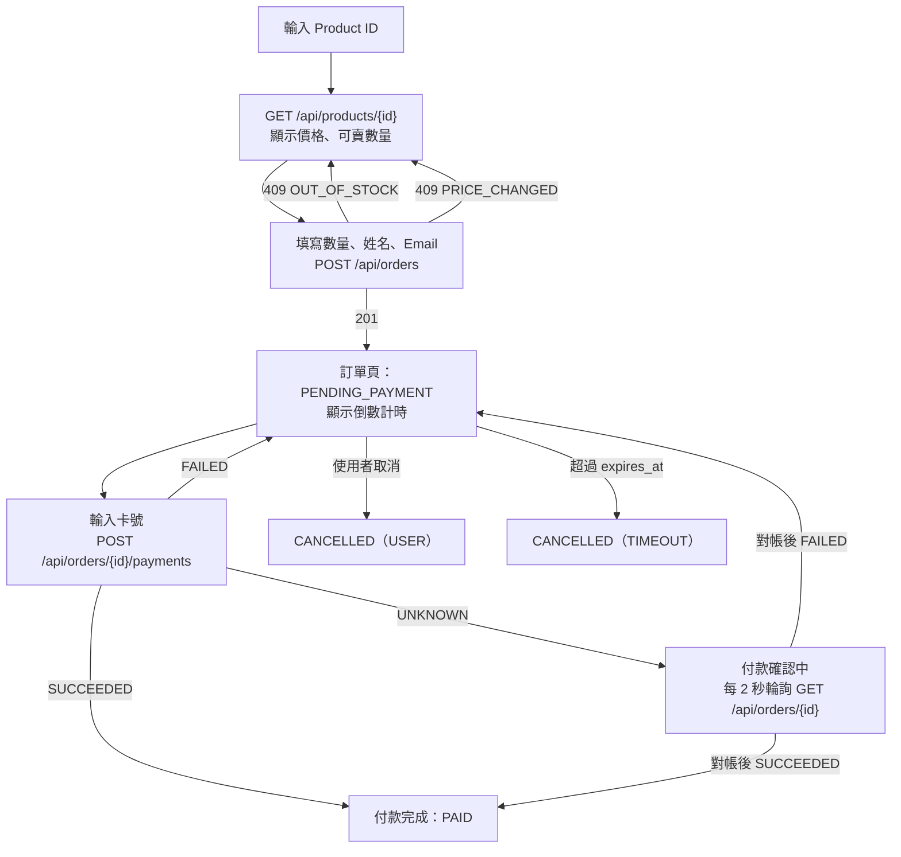

# 結帳流程與 API

> 本文件說明每個操作的交易步驟與 SQL。狀態規則見 [state-machines.md](./state-machines.md)，元件與時序圖見 [architecture.md](./architecture.md)。
> SQL 中寫成具體數字的時間（例如 `10 minutes`、`2 minutes`）只是為了好讀，實作一律取自 `config/checkout.php`（§二），以參數帶入。

## 一、整體流程



## 二、時間設定

| 設定 | 值 | 說明 |
|---|---|---|
| 訂單保留期限 `expires_at` | 下單後 10 分鐘 | 前端顯示倒數計時 |
| 付款截止 | `expires_at` 前 2 分鐘 | 超過就不能再發起付款，避免付款進行到一半時訂單到期。API 以 `pay_deadline_at` 欄位提供（§九） |
| 呼叫金流的逾時 | 10 秒 | 超過就把付款轉成 `UNKNOWN` |
| 一個 HTTP 請求最長的執行時間 | 30 秒 | php-fpm 的 `request_terminate_timeout`，超過就強制結束 worker。保證「卡在 `PROCESSING` 的請求」一定在對帳的安全等待時間之前結束（[trade-offs.md](./trade-offs.md) #37） |
| 對帳的安全等待時間 | 2 分鐘 | 只處理最後更新超過 2 分鐘的 `PROCESSING`／`UNKNOWN` |
| 逾時任務、對帳任務 | 每分鐘執行 | Laravel Scheduler，加上 `withoutOverlapping()` |

以上數值都放在 `config/checkout.php`，Demo 時可以用環境變數縮短：

| config key | 環境變數 | 預設值 |
|---|---|---|
| `checkout.order_ttl_minutes` | `CHECKOUT_ORDER_TTL_MINUTES` | `10` |
| `checkout.payment_cutoff_minutes` | `CHECKOUT_PAYMENT_CUTOFF_MINUTES` | `2` |
| `checkout.gateway_timeout_seconds` | `CHECKOUT_GATEWAY_TIMEOUT_SECONDS` | `10` |
| `checkout.request_terminate_timeout_seconds` | `PHP_FPM_REQUEST_TERMINATE_TIMEOUT` | `30`。**和 php-fpm pool 設定共用同一個環境變數**（`docker/app/php-fpm-pool.conf`：`request_terminate_timeout = ${PHP_FPM_REQUEST_TERMINATE_TIMEOUT}`，沒有單位時就是秒），所以啟動檢查讀到的值就是 php-fpm 實際使用的值 |
| `checkout.reconcile_safe_wait_seconds` | `CHECKOUT_RECONCILE_SAFE_WAIT_SECONDS` | `120` |
| `checkout.sweep_batch_size` | `CHECKOUT_SWEEP_BATCH_SIZE` | `100`（§6.2、§6.3 的 `LIMIT`） |
| `checkout.mock_gateway.webhook_secret` | `MOCK_GATEWAY_WEBHOOK_SECRET` | 無預設值，必填。repo 與 `.env.example` 都是空的；local 由 `docker/app/entrypoint.sh` 在 `backend/.env` 的值為空時用隨機的 32 bytes 寫入（已有值則保留）。空字串時所有 webhook 都視為驗簽失敗；非 `local`／`testing` 環境的規則見 §5.2 第 0 步 |
| `checkout.mock_gateway.webhook_url` | `MOCK_GATEWAY_WEBHOOK_URL` | `http://app/api/webhooks/payments`（compose 的 service 名稱；app 與 scheduler 容器都解析得到） |
| `checkout.rate_limits.place_order` | `RATE_LIMIT_PLACE_ORDER` | `10`（每個 IP 每分鐘，`POST /api/orders`）。`.env.example`（local demo）放寬為 `1000` |
| `checkout.rate_limits.start_payment` | `RATE_LIMIT_START_PAYMENT` | `10`（每個 IP 每分鐘，`POST /api/orders/{id}/payments`）。`.env.example` 為 `1000` |
| `checkout.rate_limits.read` | `RATE_LIMIT_READ` | `120`（每個 IP 每分鐘，`GET /api/products`、`GET /api/products/{id}`、`GET /api/orders/{id}` 共用）。`.env.example` 為 `1000` |

限流的預設值是嚴格的正式環境值；`.env.example` 放寬為 `1000`，因為併發測試與 E2E 會在短時間內從同一個 IP 大量呼叫 API（`phpunit.xml` 另外設成更大的值）。限流規則見 §9.1，取捨見 [trade-offs.md](./trade-offs.md) #41。

**啟動檢查**（`App\Support\StartupChecks`，在 `AppServiceProvider::boot()` 執行，每個 process 只檢查一次；違反時寫 error log，不阻擋啟動）：

| 檢查 | 預設值是否滿足 | 違反時的風險 |
|---|---|---|
| `webhook_secret` 不是空字串（所有環境）；非 `local`／`testing` 時另外要求長度 ≥ 32、不像範例值（包含 `changeme`、`example`、`your-`、`replace`、`placeholder` 等片段） | local 由 entrypoint 產生隨機值 | 空字串：所有 webhook 都回 401，付款結果只能靠同步回應與對帳。非 local 不符合規則：webhook 一律回 500（fail closed，§5.2 第 0 步），付款結果同樣改由同步回應與對帳處理 |
| `payment_cutoff_minutes < order_ttl_minutes` | 2 < 10 | 訂單一建立就不能付款 |
| `gateway_timeout_seconds < request_terminate_timeout_seconds` | 10 < 30 | worker 在金流逾時之前就被殺掉，付款停在 `PROCESSING`，無法轉成 `UNKNOWN` |
| `reconcile_safe_wait_seconds ≥ 2 × request_terminate_timeout_seconds` | 120 ≥ 60 | 對帳可能把仍在執行的付款判成 `FAILED(NOT_FOUND_AT_GATEWAY)`，之後該請求拿到 `SUCCEEDED` → `STATUS_CONFLICT`（INV-09） |

---

## 三、下單

### 3.1 交易前：計算價格

0. 先用 `Idempotency-Key` 查詢既有訂單（§八「處理順序」）；已存在就直接回傳或回 422，**不再執行下面的檢查**。否則重送一筆已成功的請求時，可能因為價格或上限已經改變而被誤判成 `PRICE_CHANGED`
1. 讀取商品，檢查 `is_active`，以及 `quantity <= max_quantity_per_order`
2. `PriceCalculator` 計算出 `PriceQuote`（見 [extensibility.md](./extensibility.md)）
3. 和前端傳來的 `expected_total` 比對；不一致就回傳 `409 PRICE_CHANGED`，並附上新的金額

前端傳來的金額**只用來比對**，不會被寫進資料庫。寫入的金額一律以後端計算的結果為準。

**輸入一律先正規化型別**：`PlaceOrderRequest` 通過驗證之後，輸出一份轉好型別的輸入（`product_id`、`quantity`、`expected_total` 轉成 `int`；字串已由 Laravel 的 `TrimStrings` 去掉前後空白）。`request_hash`（§八）與 `PlaceOrder` **使用同一份**。Laravel 的 `integer` 規則接受字串 `"2"`，`validated()` 會原樣回傳；不轉型的話，`expected_total: "1600"` 和計算出的 `1600` 嚴格比較會不相等而被誤判成 `PRICE_CHANGED`，同一個請求用 `2` 和 `"2"` 送出也會算出不同的 `request_hash`（取捨見 [trade-offs.md](./trade-offs.md) #39）。

### 3.2 交易內

```sql
BEGIN;

-- 1. 先建立訂單：uq_orders_idempotency_key 會先擋掉重複的請求
INSERT INTO orders (id, status, customer_name, customer_email, subtotal, discount_amount,
                    total_amount, idempotency_key, request_hash, expires_at)
VALUES (:uuid7, 'PENDING_PAYMENT', ..., now() + interval '10 minutes');  -- checkout.order_ttl_minutes

INSERT INTO order_items (order_id, product_id, product_name, is_inventory_tracked,
                         list_price, unit_price, quantity, discount_amount, line_total)
VALUES (...);

INSERT INTO order_status_histories (order_id, from_status, to_status, actor_type)
VALUES (:order_id, NULL, 'PENDING_PAYMENT', 'CUSTOMER');

-- 2. 最後才扣庫存（只處理 LIMITED 明細；多個商品時依 product_id 排序，避免 deadlock）
UPDATE inventories
   SET available = available - :qty,
       reserved  = reserved  + :qty,
       updated_at = now()
 WHERE product_id = :product_id
   AND available >= :qty;
-- affected rows = 0 → ROLLBACK，回傳 409 OUT_OF_STOCK

INSERT INTO inventory_ledger (product_id, order_id, type, quantity)
VALUES (:product_id, :order_id, 'RESERVE', :qty);

COMMIT;
```

- **先 INSERT 訂單，最後才扣庫存**：`inventories` 的那一列是熱點，越晚取得 row lock、越早 COMMIT，其他請求等待的時間就越短
- **條件式 UPDATE 同時完成「檢查」和「扣減」**：不會發生「先讀到還有 1 件，另一個請求也讀到 1 件，兩邊都扣成功」的 check-then-act 問題
- **UNLIMITED 商品**：`UnlimitedInventory` 什麼都不做，所以整個交易不會碰到 `inventories`

---

## 四、付款

### 4.1 發起付款（`StartPayment`）

Idempotency-Key 要查**兩次**：加鎖前一次、`FOR UPDATE` 之後一次（取捨見 [trade-offs.md](./trade-offs.md) #35）。

```sql
-- 0. 加鎖前：用 key 查詢既有付款（§八「處理順序」）
SELECT id, order_id, request_hash FROM payments WHERE idempotency_key = :key;
-- 有 → request_hash 相同：回傳重送結果（§9.6）；不同：422 IDEMPOTENCY_KEY_REUSED。不執行以下步驟

-- 交易 1：建立付款紀錄
BEGIN;
SELECT status, expires_at, total_amount FROM orders WHERE id = :order_id FOR UPDATE;

-- 1. 加鎖後：再用 key 查詢一次（必須在檢查訂單狀態之前）
SELECT id, order_id, request_hash FROM payments WHERE idempotency_key = :key;
-- 有 → ROLLBACK，處理方式同第 0 步

-- 2. status <> 'PENDING_PAYMENT'                → 409 ORDER_NOT_PAYABLE
-- 3. now() > expires_at - interval '2 minutes'  → 422 ORDER_EXPIRING（checkout.payment_cutoff_minutes）
-- 4. 有進行中的付款                             → 409 PAYMENT_IN_PROGRESS
SELECT 1 FROM payments WHERE order_id = :order_id AND status IN ('PROCESSING', 'UNKNOWN');

INSERT INTO payments (id, order_id, provider, idempotency_key, request_hash, amount, status, card_last4)
VALUES (:uuid7, :order_id, 'MOCK', :key, :hash, :total_amount, 'PROCESSING', :last4);
-- 違反 uq_payments_active           → 409 PAYMENT_IN_PROGRESS（第 4 步的第二道保險）
-- 違反 uq_payments_idempotency_key  → ROLLBACK，改為用 key 查詢，處理方式同第 0 步
COMMIT;
```

**為什麼加鎖後要再查一次 key**：同一個 key 的兩個請求同時到達時，兩個都會通過第 0 步。先拿到鎖的 A 建立付款、COMMIT、開始呼叫金流；B 拿到鎖時，A 的付款已經 COMMIT（A 持有鎖直到 COMMIT），READ COMMITTED 下 B 的下一個查詢看得到它。如果 B 不再查一次 key，就會先檢查訂單狀態：A 已經付款成功時 B 得到 409 `ORDER_NOT_PAYABLE`，A 還在呼叫金流時 B 得到 409 `PAYMENT_IN_PROGRESS`，兩者都違反「同一個 key 回傳同一筆資源」（AC-I1）。所以第 1 步必須排在第 2～4 步之前。

**為什麼還需要 `uq_payments_idempotency_key`**：同一個 key 同時送到**不同訂單**的路徑時，兩個請求鎖的是不同的訂單列，第 1 步擋不住；這時由 UNIQUE 擋下第二筆，改為查詢後因為 `request_hash` 包含路徑而回 422。程式只把**這個名稱**的約束違反轉成重送處理，其他 unique 違反照常拋出。

COMMIT 之後才呼叫 `PaymentGateway::charge()`，**呼叫外部服務時不持有任何資料庫鎖**。接著依結果處理：

| 金流的回應 | 處理方式 |
|---|---|
| 成功或失敗 | 交給 `PaymentResultHandler`（4.2） |
| 逾時（`GatewayTimeoutException`） | `PaymentStateMachine`：`UPDATE payments SET status = 'UNKNOWN' WHERE id = ? AND status = 'PROCESSING'`（0 列代表 webhook 已經先送達，不做任何事） |

**回應一律重新讀取資料庫**：上面的處理結束之後，重新讀取這筆 `payments` 與 `orders`，依**讀到的** `payment.status` 套用 §9.6 的狀態碼表組出回應；不使用 `ChargeResult` 或 handler 的回傳值組回應。理由：handler 可能沒有改變付款狀態（金額不一致時維持 `PROCESSING`、webhook 搶先處理時 CAS 是 0 列、衝突時維持原本的終止狀態），只有資料庫的值和之後 `GET /api/orders/{id}` 看到的一致。冪等重送（第 0、1 步）使用**同一段**組回應的程式。

付款金額取自 `orders.total_amount`，不接受前端傳入的金額。

### 4.2 處理付款結果（`PaymentResultHandler`）

同步回應、webhook、對帳這三個入口，都呼叫同一個 handler。整個 handler 是**一個 transaction**：

```sql
BEGIN;
-- 0. 讀取付款，比對金額：金流回報的 amount 不是 NULL 且 ≠ payments.amount
--    （對帳「查無紀錄」時沒有金額，略過比對）
UPDATE payments
   SET needs_review_at = COALESCE(needs_review_at, now()),
       review_reason   = COALESCE(review_reason, 'AMOUNT_MISMATCH'),
       updated_at = now()
 WHERE id = :payment_id;
-- → COMMIT，回傳 AMOUNT_MISMATCH（付款狀態不變），寫 alert log

-- 1. 付款 CAS
UPDATE payments
   SET status = :result, provider_trade_no = :trade_no, paid_at = :paid_at,
       failure_code = :code, updated_at = now()
 WHERE id = :payment_id AND status IN ('PROCESSING', 'UNKNOWN');
-- 0 列 → SELECT status FROM payments WHERE id = :payment_id;
--   目前狀態 = :result            → COMMIT，回傳 ALREADY_PROCESSED（冪等）
--   目前狀態是另一個終止狀態      → 標記 STATUS_CONFLICT（同第 0 步的 UPDATE）、CRITICAL log、COMMIT，回傳 CONFLICT
-- 違反 uq_payments_succeeded（同一筆訂單已經有另一筆成功的付款）
--   → ROLLBACK；另開一個 transaction 標記 DUPLICATE_SUCCESS、CRITICAL log，回傳 CONFLICT

-- 2. 只有結果是 SUCCEEDED 時才執行以下步驟
UPDATE orders SET status = 'PAID', paid_at = :paid_at, updated_at = now()
 WHERE id = :order_id AND status = 'PENDING_PAYMENT';
-- 0 列 → 不拋例外：標記 ORDER_NOT_PENDING、CRITICAL log、COMMIT（付款保持 SUCCEEDED），回傳 PROCESSED
INSERT INTO order_status_histories (...) VALUES (..., 'PENDING_PAYMENT', 'PAID', :actor, 'payment=' || :payment_id);
-- 訂單 CAS 1 列 → event(new OrderPaid($orderId))：ShouldDispatchAfterCommit，這個 transaction COMMIT 之後才發出

-- 3. 逐筆處理 is_inventory_tracked 的明細（依 product_id 排序）
UPDATE inventories SET reserved = reserved - :qty, sold = sold + :qty, updated_at = now()
 WHERE product_id = :product_id;
INSERT INTO inventory_ledger (product_id, order_id, type, quantity)
VALUES (:product_id, :order_id, 'CONFIRM', :qty);
COMMIT;
-- COMMIT 之後同步發出 OrderPaid（ROLLBACK 就不發）
-- 回傳 PROCESSED
```

handler 的回傳值（`HandlingResult`）：

| 回傳值 | 意義 | 付款狀態有沒有改變 | webhook 的 `result`／`reason`（§9.6） |
|---|---|---|---|
| `PROCESSED` | 付款 CAS 成功（包含訂單 CAS 0 列、標記 `ORDER_NOT_PENDING` 的情況） | 有 | `PROCESSED` |
| `ALREADY_PROCESSED` | 付款已經是同一個結果 | 沒有 | `PROCESSED` |
| `AMOUNT_MISMATCH` | 金額不一致，標記 `AMOUNT_MISMATCH` | 沒有 | `IGNORED`／`AMOUNT_MISMATCH` |
| `CONFLICT` | 另一個終止結果，或違反 `uq_payments_succeeded`；標記 `STATUS_CONFLICT`／`DUPLICATE_SUCCESS` | 沒有 | `IGNORED`／`STATUS_CONFLICT` |

- **訂單 CAS 0 列時一定要 COMMIT 付款的 `SUCCEEDED`，不可以拋例外**：拋例外會 ROLLBACK 付款 CAS，付款回到 `PROCESSING`／`UNKNOWN`，對帳每分鐘重試、每次都失敗，「錢已經扣了」這個事實反而沒有被記錄下來（INV-08）
- **有標記的付款由誰處理**：對帳任務不再掃描它們（§6.3），人工用 `SELECT * FROM payments WHERE needs_review_at IS NOT NULL ORDER BY needs_review_at` 查詢（`idx_payments_needs_review`），依 `review_reason` 向金流確認後處理（退款、補單）。人工處理的工具不在這次的範圍內（requirements.md §三「不做：後台管理介面」、「不做：退款」）。標記之後付款若仍是 `PROCESSING`／`UNKNOWN`，訂單會一直擋住取消與逾時、佔住庫存，**這是刻意的**：錢的狀態不明時，釋放庫存或允許重付都可能造成「扣了錢沒有貨」或重複扣款（INV-09，取捨見 [trade-offs.md](./trade-offs.md) #36）
- **`OrderPaid` 事件**：只在訂單 CAS 成功（真的轉成 `PAID`）時發出；三個入口都經過 handler，而訂單 CAS 只會成功一次，所以每筆訂單最多發出一次。`ShouldDispatchAfterCommit` 讓事件在 COMMIT 之後才同步發出，不經過 Queue（INV-01）；ROLLBACK 時不發。目前沒有 listener（[architecture.md](./architecture.md) §二、[extensibility.md](./extensibility.md) §六）

### 4.3 重新付款

付款失敗之後，前端會**產生新的 Idempotency-Key**，再呼叫一次 `POST /api/orders/{id}/payments`，於是建立一筆新的 payment。整個過程中，訂單和庫存保留都維持不變。

---

## 五、Mock 金流

### 5.1 測試卡號

| 卡號 | 金流端的紀錄 | 回給呼叫端 | 我方最後的付款狀態 |
|---|---|---|---|
| `4242 4242 4242 4242` | SUCCEEDED | 成功 | `SUCCEEDED` |
| `4000 0000 0000 0002` | FAILED（`card_declined`） | 失敗 | `FAILED`，可以重新付款 |
| `4000 0000 0000 9995` | SUCCEEDED | **逾時** | `UNKNOWN`，對帳後變成 `SUCCEEDED` |
| `4000 0000 0000 9987` | FAILED | **逾時** | `UNKNOWN`，對帳後變成 `FAILED` |
| 其他卡號 | FAILED（`invalid_card`） | 失敗 | `FAILED` |

後兩張卡用來示範：**逾時的時候，錢可能已經扣了，所以不能直接當成失敗**。

`MockPaymentGateway` 處理 9995／9987 時，先寫入 `mock_gateway_charges`，再**立即**拋出 `GatewayTimeoutException`，不會真的等待 10 秒。模擬的是「金流端已經處理完，回應卻在路上遺失」；Demo 時不必等待，`php-fpm` 的 worker 也不會被佔住。

`MockPaymentGateway` 用 query builder 存取 `mock_gateway_charges`，沒有 Eloquent model（[database-schema.md](./database-schema.md) §五）。

### 5.2 Webhook

`POST /api/webhooks/payments`

```json
{
  "event": "charge.succeeded",
  "charge_id": "ch_01J...",
  "merchant_reference": "0192...-payment-uuid",
  "amount": 800,
  "status": "SUCCEEDED",
  "failure_code": null,
  "occurred_at": "2026-10-19T12:00:00Z"
}
```

Header 帶 `X-Mock-Signature`，內容是用共用金鑰（`MOCK_GATEWAY_WEBHOOK_SECRET`）對 raw body 計算的 HMAC-SHA256，以小寫 hex 表示。

**payload 的驗證規則**（驗簽成功之後才檢查；不符合時 400 `INVALID_PAYLOAD`）：

| 欄位 | 規則 |
|---|---|
| `charge_id` | 必填，非空字串 |
| `merchant_reference` | 必填，字串。**不是 UUID 格式時不是 400**，而是視為找不到付款（`IGNORED`／`UNKNOWN_PAYMENT`）；查詢 `payments` 之前先用 `Str::isUuid()` 檢查，避免 PostgreSQL 的 uuid 語法錯誤變成 500 |
| `amount` | 必填，integer，≥ 1 |
| `status` | 必填，`SUCCEEDED` 或 `FAILED`（其他值 400） |
| `failure_code` | string 或 null |
| `occurred_at` | 必填，ISO 8601 時間 |

**處理步驟與交易範圍**（取捨見 [trade-offs.md](./trade-offs.md) #38）：

0. **金鑰不可用時 fail closed**：`APP_ENV` 不是 `local`／`testing`，而且 `StartupChecks::webhookSecretProblem()` 回報問題（secret 是空字串、長度小於 32，或像範例值，§二「啟動檢查」）時，直接回傳 500 `INTERNAL_ERROR`：不驗簽、**不寫入 `payment_events`**、不交給 handler。原因已由啟動檢查寫進 error log，這裡不再每個請求寫一次（避免用請求量灌 log）。`local`／`testing` 不做這一步：local 的 secret 由 entrypoint 隨機產生；secret 是空字串時照常走第 2 步，一律驗簽失敗、回 401
1. 解析 raw body，算出以下兩個值（只處理字串，**不查詢資料庫**；驗簽成功與失敗的事件都使用它們）：
   - `payload`：raw body 解析後的 JSON；不是合法 JSON 時存成 `{"_raw": "<原始字串>"}`
   - `event_key`：`charge_id` 與 `status` 都是非空字串時為 `charge_id + ':' + status`；否則為 `invalid:` + raw body 的 SHA-256
2. 用 `hash_equals` 驗證簽章（金鑰是空字串時一律視為失敗）。失敗：INSERT 一筆 `signature_valid = false` 的事件（`payload`、`event_key` 是第 1 步的值，**`payment_id` 一律是 NULL**），回傳 401 `INVALID_SIGNATURE`
3. 驗簽成功之後才算出 `payment_id`：`merchant_reference` 是 UUID 而且找得到付款時為該付款，否則為 NULL
4. **INSERT `payment_events`（`signature_valid = true`），不在任何 transaction 內，獨立 COMMIT**。違反 `uq_payment_events_valid` 時，讀出既有事件：
   - 既有事件的 `processed_at` 有值 → 回傳 200 `DUPLICATE`，結束
   - `processed_at` 是 NULL（上一次處理到一半就失敗，或同一個事件正在被另一個請求處理）→ 沿用既有事件的 `id`，用**這次請求的** payload 繼續第 5 步
5. payload 不符合驗證規則 → 回傳 400 `INVALID_PAYLOAD`（`processed_at` 保持 NULL，重送時會再得到 400）
6. 找不到對應的付款 → 填入 `processed_at`，回傳 200（`IGNORED`／`UNKNOWN_PAYMENT`），寫入警報 log，不交給 handler
7. 交給 `PaymentResultHandler`（actor 為 `WEBHOOK`；handler 自己的 transaction，§4.2）
8. `UPDATE payment_events SET processed_at = now() WHERE id = :id AND processed_at IS NULL`，依 handler 的回傳值回應（§4.2 的對照表）

**為什麼金鑰不可用時回 500，而不是照常驗簽**：太短或範例值的金鑰可能已經公開（出現在文件、`.env.example`、教學），攻擊者可以用它簽出「合法」的通知，讓付款被標成 `SUCCEEDED`。這是部署設定錯誤，不是請求的問題，所以回 5xx（金流端會重送，修好設定後重送的通知就能正常處理），也不寫入 `payment_events`：此時連「驗簽成功」都不可信，寫入 `signature_valid = true` 的事件會佔住真正事件的 `event_key`（INV-12）。付款結果仍然由同步回應與對帳處理（三條路徑互為備援）。

**為什麼驗簽失敗的事件 `payment_id` 一律是 NULL**：簽章錯誤代表 body 的內容不可信，`merchant_reference` 可能是攻擊者隨意填的。(1) 不用未驗證的輸入去查詢 `payments`，省掉一次由攻擊者決定的資料庫查詢；(2) 不讓偽造的事件掛在一筆真實的付款底下，人工檢視某筆付款的事件時，看到的一定都是驗簽成功的通知。驗簽失敗的事件仍然完整保存 `payload` 與 `event_key`，要追查攻擊時從 `payload` 就能看出它聲稱的 `merchant_reference`。這和 [database-schema.md](./database-schema.md) §五 `payment_events.payment_id` 的定義一致；`payload`、`event_key` 在驗簽之前就算好，是因為兩種事件都要寫入這兩個 `NOT NULL` 欄位，計算方式也相同。

**為什麼事件的 INSERT 要獨立 COMMIT**：PostgreSQL 在 transaction 內遇到 unique violation 時，整個 transaction 會變成 aborted，之後的 SQL 全部失敗；「捕捉違反、改為讀取既有事件」在同一個 transaction 內做不到。另外，先 COMMIT 原始事件，第 7 步失敗（例如資料庫連線中斷）時事件仍然留著、`processed_at` 是 NULL，金流重送時會重新交給 handler；就算金流不再重送，對帳任務也會從金流端查到結果（三條路徑互為備援，對帳是最後的保障）。

**兩個相同事件同時到達**：A INSERT 成功、B 違反 unique 且讀到 `processed_at` 是 NULL，兩者都會交給 handler；handler 的付款 CAS 保證只有一方生效，另一方得到 `ALREADY_PROCESSED`，兩個回應都是 200 `PROCESSED`。所以「第二次送出得到 `DUPLICATE`」只在第一次已經處理完之後成立（Demo 6 是依序按兩次，符合這個條件）。

Mock 金流**不會主動**送出 webhook。Demo 面板上的「送出 webhook」按鈕，以及 `php artisan mock-gateway:webhook {payment}` 指令，會依 `mock_gateway_charges` 的紀錄組出事件，由 app 對 `MOCK_GATEWAY_WEBHOOK_URL` 發出一個真正的 HTTP 請求，用來示範重送與冪等。這筆付款在金流端沒有紀錄時（例如停在 `PROCESSING`、還沒呼叫金流），指令以非 0 的 exit code 結束。

---

## 六、取消與逾時

### 6.1 取消（`CancelOrder`）與逾時（`ExpireOrder`）

兩者的交易內容相同，只有前提條件和 `cancel_reason` 不一樣：

```sql
BEGIN;
SELECT status, expires_at FROM orders WHERE id = :order_id FOR UPDATE;
-- 取消：status <> 'PENDING_PAYMENT' → 409 ORDER_NOT_CANCELLABLE
-- 逾時：expires_at > now() → 跳過

SELECT 1 FROM payments WHERE order_id = :order_id AND status IN ('PROCESSING', 'UNKNOWN');
-- 有資料：取消回傳 409 PAYMENT_IN_PROGRESS；逾時則跳過，等下一輪再處理

UPDATE orders SET status = 'CANCELLED', cancelled_at = now(), cancel_reason = :reason, updated_at = now()
 WHERE id = :order_id AND status = 'PENDING_PAYMENT';
INSERT INTO order_status_histories (...) VALUES (..., 'PENDING_PAYMENT', 'CANCELLED', :actor, :reason);

-- 逐筆處理 is_inventory_tracked 的明細
UPDATE inventories SET available = available + :qty, reserved = reserved - :qty, updated_at = now()
 WHERE product_id = :product_id;
INSERT INTO inventory_ledger (product_id, order_id, type, quantity)
VALUES (:product_id, :order_id, 'RELEASE', :qty);
COMMIT;
```

### 6.2 逾時任務（`orders:expire`，每分鐘執行）

```sql
SELECT o.id FROM orders o
 WHERE o.status = 'PENDING_PAYMENT'
   AND o.expires_at < now()
   AND NOT EXISTS (SELECT 1 FROM payments p
                    WHERE p.order_id = o.id AND p.status IN ('PROCESSING', 'UNKNOWN'))
 ORDER BY o.expires_at
 LIMIT 100;            -- checkout.sweep_batch_size；使用 partial index idx_orders_expire_sweep，
                       -- NOT EXISTS 使用 uq_payments_active（同樣的 partial 條件）
```

對每一筆訂單分別執行 `ExpireOrder`，每筆訂單是一個獨立的 transaction，單筆失敗不會影響其他筆。

**為什麼掃描要排除有進行中付款的訂單**：不排除的話，有 `UNKNOWN` 付款（或標記需要人工處理、一直停在 `UNKNOWN` 的付款）的訂單會永遠排在 `expires_at` 最前面；這類訂單超過 `LIMIT` 筆時，每一輪都只掃到它們、全部跳過，後面真正該釋放的訂單永遠輪不到。掃描的 `NOT EXISTS` 只是篩選，**正確性仍然由 `ExpireOrder` 在 `FOR UPDATE` 之後重新檢查保證**（INV-10）：掃描之後才建立的付款，會在鎖內被查到而跳過。

**`--force`（只在 `APP_ENV` 是 `local` 或 `testing` 時允許，`/api/demo/expire` 使用）**：掃描與 `ExpireOrder` 都**只略過 `expires_at` 的條件**；`NOT EXISTS`、`FOR UPDATE`、進行中付款的檢查、訂單 CAS 完全不變，所以有 `PROCESSING`／`UNKNOWN` 付款的訂單仍然會被跳過（INV-09、INV-10）。其他環境帶 `--force` 時，指令直接以 exit code 1 結束（取捨見 [trade-offs.md](./trade-offs.md) #30）。

### 6.3 對帳任務（`payments:reconcile`，每分鐘執行）

```sql
SELECT id FROM payments
 WHERE status IN ('PROCESSING', 'UNKNOWN')
   AND needs_review_at IS NULL
   AND updated_at < now() - interval '2 minutes'   -- checkout.reconcile_safe_wait_seconds
 ORDER BY updated_at
 LIMIT 100;            -- checkout.sweep_batch_size；使用 partial index idx_payments_reconcile
                       -- （partial 條件和這裡的 status、needs_review_at 條件相同）
```

對每一筆呼叫 `PaymentGateway::query(payment_id)`，依結果處理：

- 查到紀錄：交給 `PaymentResultHandler`，actor 為 `SYSTEM`
- 查無紀錄：同樣交給 `PaymentResultHandler`，結果為 `FAILED`、`failure_code` 為 `NOT_FOUND_AT_GATEWAY`、沒有金額（略過金額比對）、`provider_trade_no` 為 NULL（付款的終止狀態只能由 handler 寫入，INV-08）

**為什麼要 `ORDER BY updated_at` 並排除 `needs_review_at`**：沒有排序時，每一輪拿到的 100 筆沒有保證，可能一直是同一批；排除有標記的付款，是因為 handler 拒絕處理它們（金額不一致），每一輪查到的結果都一樣。不排除的話，它們的 `updated_at` 會一直是最舊的，永遠排在最前面，超過 `LIMIT` 筆時其他付款永遠輪不到。

逾時任務遇到有 `UNKNOWN` 付款的訂單時會先跳過。等對帳把付款處理完，下一輪逾時任務才會釋放這筆訂單的庫存。

**`--force`（只在 `APP_ENV` 是 `local` 或 `testing` 時允許，`/api/demo/reconcile` 使用）**：只對 `UNKNOWN` 的付款略過安全等待時間；`PROCESSING` 的付款仍然要等滿 2 分鐘。這只在 Mock 金流成立：`MockPaymentGateway` 先寫入 `mock_gateway_charges` 再拋出逾時（§5.1），`UNKNOWN` 出現時金流端的紀錄一定已經存在，立即查詢不會誤判。**真實金流的逾時不代表請求已經不在路上**（請求可能還在金流端排隊），所以真實環境的 `UNKNOWN` 仍然必須等滿安全等待時間；`--force` 只在 `local`／`testing` 允許，正是因為這個前提只對 Mock 成立。`PROCESSING` 則連 Mock 都可能是正在進行中的請求，略過等待就可能把即將成功的付款判成 `FAILED`（INV-09，取捨見 [trade-offs.md](./trade-offs.md) #30）。

---

## 七、庫存對帳

```sql
SELECT i.product_id,
       i.available, i.reserved, i.sold,
       COALESCE(SUM(l.quantity) FILTER (WHERE l.type IN ('RESTOCK','ADJUST')), 0)
     - COALESCE(SUM(l.quantity) FILTER (WHERE l.type = 'RESERVE'), 0)
     + COALESCE(SUM(l.quantity) FILTER (WHERE l.type = 'RELEASE'), 0) AS ledger_available,
       COALESCE(SUM(l.quantity) FILTER (WHERE l.type = 'RESERVE'), 0)
     - COALESCE(SUM(l.quantity) FILTER (WHERE l.type IN ('RELEASE','CONFIRM')), 0) AS ledger_reserved,
       COALESCE(SUM(l.quantity) FILTER (WHERE l.type = 'CONFIRM'), 0) AS ledger_sold
  FROM inventories i
  LEFT JOIN inventory_ledger l ON l.product_id = i.product_id
 GROUP BY i.product_id;
```

三組數字都必須相等。這個查詢會放進 `/demo` 面板和併發測試的斷言中。

UNLIMITED 商品沒有 `inventories` 列，不在這個查詢的結果裡；`/demo` 面板另外檢查它在 `inventory_ledger` 的筆數必須是 0（INV-04）。

---

## 八、Idempotency

所有會寫入資料的 API（`POST /api/orders`、`POST /api/orders/{id}/payments`），都必須帶 `Idempotency-Key` header（UUID，由前端用 `crypto.randomUUID()` 產生）。沒有帶、或不是 UUID 格式時，回傳 400 `IDEMPOTENCY_KEY_REQUIRED`。

| 情況 | 處理方式 |
|---|---|
| 新的 key | 正常處理 |
| key 已存在，請求內容相同 | 回傳同一筆資源，不重複執行（回應內容的定義見 §9.1「冪等重送的回應」） |
| key 已存在，請求內容不同 | 422 `IDEMPOTENCY_KEY_REUSED` |
| 兩個相同 key 的下單請求同時到達 | 後到的 INSERT 會等待先到的交易結束：先到的 COMMIT 了，後到的就違反 `uq_orders_idempotency_key`，ROLLBACK 後改成查詢並回傳既有的結果；先到的 ROLLBACK 了，後到的就正常執行 |
| 兩個相同 key 的付款請求同時到達 | 同一筆訂單：後到的在 `FOR UPDATE` 之後再查一次 key，回傳既有的付款（§4.1 第 1 步）；不同訂單：後到的違反 `uq_payments_idempotency_key`，改成查詢（§4.1） |
| 第一次請求失敗（例如缺貨） | 交易已經 ROLLBACK，key 沒有被保存，使用同一個 key 重試會重新執行 |
| 被限流（429 `TOO_MANY_REQUESTS`） | `throttle` middleware 排在 `idempotency` middleware 之前，請求在讀取 key、存取資料庫之前就被拒絕，key 沒有被使用；等 `Retry-After` 秒數後**用同一個 key 重試**即可 |

**只認明確命名的約束**：捕捉 unique violation（SQLSTATE `23505`）時，用例外中的約束名稱判斷，只有 `uq_orders_idempotency_key`、`uq_payments_idempotency_key` 轉成重送處理；`uq_payments_active` 轉成 409 `PAYMENT_IN_PROGRESS`；其他約束照常拋出（[database-schema.md](./database-schema.md) §四、§五）。

**key 的產生時機**：

- 下單：進入結帳頁時產生一次，下單成功後就不再使用
- 付款：每次按下「付款」時產生。付款失敗後要重試時，**一定要產生新的 key**，因為那是一次新的付款嘗試

`request_hash` 的內容是 `sha256(HTTP method + 路徑 + 排序後的 JSON body)`，只使用通過驗證、**並轉好型別**的欄位（§3.1）：`2` 和 `"2"` 會算出相同的 hash（取捨見 [trade-offs.md](./trade-offs.md) #39）。

**付款的例外**：付款的 body 含有卡號，完整卡號的 SHA-256 可以被暴力還原（卡號的空間很小），等於間接存了卡號（INV-13）。所以付款的 `request_hash` 計算時，把 `card_number` 換成末四碼、移除 `exp` 和 `cvc`：`sha256("POST" + 路徑 + {"card_last4": "4242"})`。代價是「同一個 key、末四碼相同的另一張卡」會被當成相同的請求，回傳第一次的結果；同一個 key 本來就只應該對應同一次點擊，這個代價可以接受（取捨見 [trade-offs.md](./trade-offs.md) #33）。

---

## 九、API

### 9.1 共通規則

| 項目 | 規則 |
|---|---|
| Base path | `/api`，和 SPA 同一個 origin，不需要 CORS。`config/cors.php` 設 `paths => []`：不對任何路徑輸出 CORS header，瀏覽器的跨來源請求一律被擋下，只允許同一個 origin（[trade-offs.md](./trade-offs.md) #32） |
| Content-Type | 請求與回應都是 `application/json`。`/api` 底下的任何錯誤（包含 404、405、500）都回傳 JSON，不回傳 HTML |
| 成功的回應 | `{ "data": ... }` |
| 失敗的回應 | `{ "error": { "code": string, "message": string, "details": object } }`（9.2） |
| 金額 | JSON integer，單位是新台幣元（TWD），沒有小數。欄位：`price`、`list_price`、`unit_price`、`line_total`、`subtotal`、`discount_amount`、`total_amount`、`amount`、`expected_total` |
| 時間 | ISO 8601 的 UTC 字串，精確到秒，結尾是 `Z`，例如 `"2026-10-19T12:10:00Z"`（Carbon 的 `toIso8601ZuluString()`）。前端用 `new Date()` 解析後再轉成當地時間顯示 |
| ID | 商品 `id`、`product_id`、`payment_events.id` 是 JSON integer；訂單 `id`、付款 `id`、`order_id`、`payment_id` 是小寫的 UUID 字串（36 個字元，UUIDv7）。`order_status_histories.id` 是全站遞增的流水號，**不出現在顧客看得到的回應裡**（會洩漏全站的訂單量） |
| Enum | 大寫字串，和資料庫的 `CHECK` 完全相同（例如 `"PENDING_PAYMENT"`）。例外：`failure_code` 沿用金流的原始值（`"card_declined"`、`"invalid_card"`），以及我方的 `"NOT_FOUND_AT_GATEWAY"` |
| `null` | 欄位一律輸出；沒有值時是 `null`，不會省略欄位 |
| 列表 | 不分頁 |
| 冪等重送 | 回應多一個 header：`Idempotent-Replayed: true` |
| 卡號 | 任何回應、錯誤訊息都只會出現 `card_last4`，不會出現完整卡號、`exp`、`cvc`（INV-13） |
| 個人資料 | `customer_email` 回傳完整 Email（9.5）。使用者決定練習專案不遮罩（2026-10-20） |
| 限流 | 以來源 IP 為 key，每分鐘的額度取自 `config/checkout.php` 的 `rate_limits`（§二）：`POST /api/orders`（`place_order`，預設 10）、`POST /api/orders/{id}/payments`（`start_payment`，預設 10）、`GET /api/products`、`GET /api/products/{id}`、`GET /api/orders/{id}`（`read`，三者共用，預設 120）。超過時回 429 `TOO_MANY_REQUESTS`，帶 `Retry-After` header（同時帶 `X-RateLimit-Limit`、`X-RateLimit-Remaining`）。**不限流**：`POST /api/webhooks/payments`（金流的重送不可以被擋，且有 HMAC 驗簽）、`GET /api/health`、`/api/demo/*`（只在 `local`／`testing` 存在）。計數器存在 `CACHE_STORE=file`（[trade-offs.md](./trade-offs.md) #41） |

**冪等重送的回應**：key 存在業務表上（[trade-offs.md](./trade-offs.md) #20），重送時依**資源目前的狀態**組出回應，而不是保存第一次的回應內容（取捨見 #27；這個解釋已由使用者確認，2026-10-19）：

- 回傳的是**同一筆**訂單或付款（`id` 相同），不會建立新的資料
- HTTP 狀態碼：`POST /api/orders` 一律 201；`POST /api/orders/{id}/payments` 依付款**目前的** `status` 決定（9.6）
- 欄位值是目前的狀態。例如第一次回應時付款是 `UNKNOWN`，對帳後重送，會拿到 `SUCCEEDED`

### 9.2 錯誤碼

`code` 是穩定的識別字，前端只依 `code` 判斷；`message` 是可以直接顯示給使用者的中文；`details` 永遠是物件，沒有內容時是 `{}`。

| HTTP | `code` | 端點 | `details` |
|---|---|---|---|
| 400 | `IDEMPOTENCY_KEY_REQUIRED` | `POST /api/orders`、`POST /api/orders/{id}/payments` | `{}` |
| 400 | `INVALID_PAYLOAD` | `POST /api/webhooks/payments`（§5.2 的驗證規則） | `{}` |
| 401 | `INVALID_SIGNATURE` | `POST /api/webhooks/payments` | `{}` |
| 404 | `PRODUCT_NOT_FOUND` | `GET /api/products/{id}`、`POST /api/orders` | `{}` |
| 404 | `ORDER_NOT_FOUND` | `GET /api/orders/{id}`、`POST .../payments`、`POST .../cancel`（`{id}` 不是 UUID 格式時也是這個錯誤） | `{}` |
| 404 | `PAYMENT_NOT_FOUND` | `POST /api/demo/payments/{id}/webhook` | `{}` |
| 404 | `NOT_FOUND` | 其他不存在的 `/api` 路徑；`APP_ENV` 不是 `local`／`testing` 時的 `/api/demo/*`（由 middleware 回傳，9.3） | `{}` |
| 405 | `METHOD_NOT_ALLOWED` | 全部（例如對 `/api/orders` 送 `GET`） | `{}` |
| 4xx（沿用原本的狀態碼） | `BAD_REQUEST` | 全部。其他沒有專屬錯誤碼的 4xx，例如格式錯誤的 JSON、413 Payload Too Large | `{}`；`message` 固定為「請求無法處理」 |
| 409 | `PRODUCT_INACTIVE` | `POST /api/orders` | `{}` |
| 409 | `PRICE_CHANGED` | `POST /api/orders` | `{ "expected_total": int, "total_amount": int }`：前端送來的金額、後端算出的新金額 |
| 409 | `OUT_OF_STOCK` | `POST /api/orders` | `{ "product_id": int, "requested_quantity": int }`；不包含剩餘數量（[trade-offs.md](./trade-offs.md) #4），前端要重新呼叫 `GET /api/products/{id}` |
| 409 | `ORDER_NOT_PAYABLE` | `POST .../payments` | `{ "status": "PAID" \| "CANCELLED" }` |
| 409 | `PAYMENT_IN_PROGRESS` | `POST .../payments`、`POST .../cancel` | `{}`；前端重新呼叫 `GET /api/orders/{id}` |
| 409 | `ORDER_NOT_CANCELLABLE` | `POST .../cancel` | `{ "status": "PAID" \| "CANCELLED" }` |
| 422 | `VALIDATION_FAILED` | 所有接受 body 的端點（webhook 除外，見 `INVALID_PAYLOAD`） | `{ "fields": { "<欄位>": ["訊息", ...] } }`。由 `ValidationException` 轉換，不使用 Laravel 預設的 `{ message, errors }` 格式；訊息不包含使用者輸入的值 |
| 422 | `QUANTITY_LIMIT_EXCEEDED` | `POST /api/orders` | `{ "max_quantity_per_order": int }` |
| 422 | `IDEMPOTENCY_KEY_REUSED` | `POST /api/orders`、`POST .../payments` | `{}` |
| 422 | `ORDER_EXPIRING` | `POST .../payments` | `{ "pay_deadline_at": string }` |
| 422 | `DEMO_COMMAND_FAILED` | `POST /api/demo/*` | `{ "command": string, "exit_code": int, "output": string }` |
| 429 | `TOO_MANY_REQUESTS` | `POST /api/orders`、`POST .../payments`、`GET /api/products`、`GET /api/products/{id}`、`GET /api/orders/{id}`（9.1「限流」） | `{ "retry_after_seconds": int }`；回應同時帶 `Retry-After` header（秒數相同）。前端顯示「操作太頻繁，請稍後再試」 |
| 500 | `INTERNAL_ERROR` | 全部；webhook 在非 `local`／`testing` 環境、secret 不可用時也回這個錯誤（§5.2 第 0 步） | `{}`；`message` 固定為「系統發生錯誤」，不包含例外內容（即使 `APP_DEBUG=true`） |

```json
{ "error": { "code": "PRICE_CHANGED", "message": "價格已經變動，請重新確認金額",
             "details": { "expected_total": 1600, "total_amount": 1800 } } }
```

```http
HTTP/1.1 429 Too Many Requests
Retry-After: 42

{ "error": { "code": "TOO_MANY_REQUESTS", "message": "請求太頻繁，請稍後再試",
             "details": { "retry_after_seconds": 42 } } }
```

### 9.3 端點總覽

| Method | Endpoint | 說明 | 成功 | 可能的錯誤 |
|---|---|---|---|---|
| GET | `/api/products` | 商品列表（Demo 用） | 200 | 429 `TOO_MANY_REQUESTS` |
| GET | `/api/products/{id}` | 商品資訊 | 200 | 404 `PRODUCT_NOT_FOUND`、429 `TOO_MANY_REQUESTS` |
| POST | `/api/orders` | 建立訂單，並保留 LIMITED 商品的庫存 | 201 | 400 `IDEMPOTENCY_KEY_REQUIRED`、404 `PRODUCT_NOT_FOUND`、409 `OUT_OF_STOCK`、409 `PRICE_CHANGED`、409 `PRODUCT_INACTIVE`、422 `VALIDATION_FAILED`、422 `QUANTITY_LIMIT_EXCEEDED`、422 `IDEMPOTENCY_KEY_REUSED`、429 `TOO_MANY_REQUESTS` |
| GET | `/api/orders/{id}` | 訂單、明細、付款紀錄、狀態歷史 | 200 | 404 `ORDER_NOT_FOUND`、429 `TOO_MANY_REQUESTS` |
| POST | `/api/orders/{id}/payments` | 發起付款或重新付款 | 200／202 | 400 `IDEMPOTENCY_KEY_REQUIRED`、404 `ORDER_NOT_FOUND`、409 `ORDER_NOT_PAYABLE`、409 `PAYMENT_IN_PROGRESS`、422 `VALIDATION_FAILED`、422 `ORDER_EXPIRING`、422 `IDEMPOTENCY_KEY_REUSED`、429 `TOO_MANY_REQUESTS` |
| POST | `/api/orders/{id}/cancel` | 取消訂單 | 200 | 404 `ORDER_NOT_FOUND`、409 `ORDER_NOT_CANCELLABLE`、409 `PAYMENT_IN_PROGRESS` |
| POST | `/api/webhooks/payments` | Mock 金流的通知（不限流） | 200 | 400 `INVALID_PAYLOAD`、401 `INVALID_SIGNATURE`、500 `INTERNAL_ERROR`（非 `local`／`testing` 且 secret 不可用，§5.2 第 0 步） |

所有端點都可能回 4xx `BAD_REQUEST`（格式錯誤的 JSON、413 等）與 500 `INTERNAL_ERROR`，上表不重複列出。

**Demo 專用 API**：路由**一律註冊**，套用 `demo.only` middleware（`App\Http\Middleware\EnsureDemoEnvironment`）。middleware 在**每個請求**讀取 `app()->environment()`，不是 `local` 或 `testing` 時回傳 404 `NOT_FOUND`（和不存在的路徑相同，不透露 Demo 端點的存在）。這樣不受 `route:cache` 影響，feature test 也能在測試內把環境切成 `production` 驗證 404（取捨見 [trade-offs.md](./trade-offs.md) #34）。`testing` 讓 feature test 可以測試這些端點（已由使用者確認，2026-10-19，requirements.md §四）；docker 的 demo 環境是 `local`。Demo 端點不限流。

| Method | Endpoint | 說明 | 執行的指令 |
|---|---|---|---|
| GET | `/api/demo/state` | 各商品的庫存三個欄位、ledger 對帳結果、最近的訂單、付款與 webhook 紀錄 | （查詢） |
| POST | `/api/demo/expire` | 立即執行逾時任務，忽略 `expires_at` 是否已到期 | `orders:expire --force` |
| POST | `/api/demo/reconcile` | 立即執行對帳，`UNKNOWN` 的付款不等待 2 分鐘 | `payments:reconcile --force` |
| POST | `/api/demo/payments/{id}/webhook` | 讓 Mock 金流送出這筆付款的 webhook | `mock-gateway:webhook {id}` |
| POST | `/api/demo/reset` | 清空所有業務資料，重新寫入 seed | `demo:reset` |

### 9.4 商品

#### `Product` 物件

| 欄位 | 型別 | 說明 |
|---|---|---|
| `id` | integer | |
| `name` | string | |
| `price` | integer | 原價（元） |
| `inventory_policy` | `"LIMITED"` \| `"UNLIMITED"` | |
| `max_quantity_per_order` | integer | 單筆訂單的購買上限，≥ 1 |
| `is_active` | boolean | `false` 時前端停用「確認下單」 |
| `available` | integer \| null | LIMITED：`inventories.available`；UNLIMITED：`null`。只是顯示用的快照，下單時以條件式 UPDATE 為準 |

#### `GET /api/products`

回傳所有商品（包含 `is_active = false`），依 `id` 由小到大排序。

```json
200 OK
{ "data": [
  { "id": 1, "name": "限量 T 恤", "price": 800, "inventory_policy": "LIMITED",
    "max_quantity_per_order": 5, "is_active": true, "available": 100 },
  { "id": 3, "name": "數位桌布包", "price": 150, "inventory_policy": "UNLIMITED",
    "max_quantity_per_order": 10, "is_active": true, "available": null }
] }
```

#### `GET /api/products/{id}`

`{id}` 不是正整數或不存在：404 `PRODUCT_NOT_FOUND`。商品已下架時仍然回傳 200（`is_active = false`），讓結帳頁顯示「已下架」。

```json
200 OK
{ "data": { "id": 1, "name": "限量 T 恤", "price": 800, "inventory_policy": "LIMITED",
            "max_quantity_per_order": 5, "is_active": true, "available": 100 } }
```

### 9.5 訂單

#### `Order` 物件

`POST /api/orders`、`GET /api/orders/{id}`、`POST .../cancel` 都回傳這個物件；`POST .../payments` 的回應也包含它。

| 欄位 | 型別 | 說明 |
|---|---|---|
| `id` | string（UUID） | 也是查詢訂單的憑證（[trade-offs.md](./trade-offs.md) #13） |
| `status` | `"PENDING_PAYMENT"` \| `"PAID"` \| `"CANCELLED"` | |
| `cancel_reason` | `"USER"` \| `"TIMEOUT"` \| null | 只有 `CANCELLED` 時有值 |
| `customer_name` | string | |
| `customer_email` | string | 完整 Email，例如 `"ming@example.com"`。使用者決定練習專案不遮罩（2026-10-20）；訂單 ID 仍是查詢憑證（#13） |
| `currency` | string | 固定是 `"TWD"` |
| `subtotal` | integer | 明細 `line_total` 的加總 |
| `discount_amount` | integer | 訂單層級的折扣，目前固定是 0 |
| `total_amount` | integer | 應付金額 |
| `expires_at` | string（時間） | 保留期限，到期後由逾時任務取消 |
| `pay_deadline_at` | string（時間） | `expires_at − payment_cutoff_minutes`；超過就不能再發起付款。**前端的倒數計時以這個欄位為準** |
| `paid_at` | string（時間）\| null | |
| `cancelled_at` | string（時間）\| null | |
| `created_at` | string（時間） | |
| `server_time` | string（時間） | 產生回應時的伺服器時間。前端用 `pay_deadline_at − server_time` 算出剩餘秒數再倒數，避免使用者電腦的時鐘不準 |
| `has_payment_in_progress` | boolean | 有沒有 `PROCESSING` 或 `UNKNOWN` 的付款。`true` 時前端每 2 秒輪詢一次 |
| `can_pay` | boolean | `status = PENDING_PAYMENT` 且 `server_time < pay_deadline_at` 且 `has_payment_in_progress = false` |
| `can_cancel` | boolean | `status = PENDING_PAYMENT` 且 `has_payment_in_progress = false` |
| `items` | `OrderItem[]` | 依 `product_id` 排序 |
| `payments` | `Payment[]` | 這筆訂單的所有付款嘗試，**新的在前**（`created_at` 由新到舊） |
| `status_histories` | `StatusHistory[]` | **舊的在前**（`created_at` 由舊到新；同時間再依內部的流水號，流水號本身不輸出） |

**`can_pay`、`can_cancel`、`has_payment_in_progress` 只是給前端決定按鈕狀態的提示**（取捨見 [trade-offs.md](./trade-offs.md) #28）。真正的判斷仍然由 `StartPayment`、`CancelOrder` 在 `SELECT ... FOR UPDATE` 之後重新執行（INV-10）；前端拿到的值過時了，送出請求也只會得到 409／422，不會破壞任何不變量。

`OrderItem`：

| 欄位 | 型別 | 說明 |
|---|---|---|
| `product_id` | integer | |
| `product_name` | string | 下單時的快照 |
| `is_inventory_tracked` | boolean | 下單時是否為 LIMITED |
| `list_price` | integer | 原價快照 |
| `unit_price` | integer | 成交單價快照（目前等於 `list_price`） |
| `quantity` | integer | |
| `discount_amount` | integer | 目前固定是 0 |
| `line_total` | integer | `unit_price × quantity − discount_amount` |

`Payment`：

| 欄位 | 型別 | 說明 |
|---|---|---|
| `id` | string（UUID） | |
| `status` | `"PROCESSING"` \| `"SUCCEEDED"` \| `"FAILED"` \| `"UNKNOWN"` | |
| `amount` | integer | 取自 `orders.total_amount` |
| `card_last4` | string | 4 個數字 |
| `failure_code` | string \| null | 只有 `FAILED` 時可能有值：金流提供的代碼（`"card_declined"`、`"invalid_card"`），或我方的 `"NOT_FOUND_AT_GATEWAY"`（**只在對帳時金流端查無紀錄**才出現，§6.3）。`FAILED` 但金流沒有提供代碼時為 null，前端顯示一般的「付款失敗」訊息 |
| `provider_trade_no` | string \| null | 金流的交易編號（`ch_...`）。`PROCESSING`、`UNKNOWN` 時為 null；`FAILED` 且 `failure_code = "NOT_FOUND_AT_GATEWAY"` 時也是 null（金流端沒有紀錄，就沒有交易編號） |
| `paid_at` | string（時間）\| null | 只有 `SUCCEEDED` 時有值 |
| `created_at` | string（時間） | |
| `updated_at` | string（時間） | |

`needs_review_at`、`review_reason` 不在顧客看得到的 `Payment` 物件裡（內部的人工處理資訊），只出現在 Demo 的 `recent_payments`（9.7）。

`StatusHistory`：

| 欄位 | 型別 | 說明 |
|---|---|---|
| `from_status` | string \| null | 建立訂單時是 null |
| `to_status` | string | |
| `actor_type` | `"CUSTOMER"` \| `"SYSTEM"` \| `"WEBHOOK"` | |
| `reason` | string \| null | 例如 `"TIMEOUT"`、`"USER"`、`"payment=<uuid>"` |
| `created_at` | string（時間） | |

不輸出 `id`：`order_status_histories.id` 是全站共用的流水號，看到兩筆訂單的 id 差值就能推算這段時間全站的訂單量。

#### `POST /api/orders`

```http
POST /api/orders
Idempotency-Key: 6f1c0e2a-4b7d-4e55-9b1a-2f3c4d5e6f70
Content-Type: application/json

{ "product_id": 1, "quantity": 2, "customer_name": "王小明",
  "customer_email": "ming@example.com", "expected_total": 1600 }
```

| 欄位 | 型別 | 驗證規則（不符合時 422 `VALIDATION_FAILED`） |
|---|---|---|
| `product_id` | integer | 必填，≥ 1（存在與否在 Action 內檢查，回傳 404 `PRODUCT_NOT_FOUND`） |
| `quantity` | integer | 必填，≥ 1（是否超過上限在 Action 內檢查，回傳 422 `QUANTITY_LIMIT_EXCEEDED`） |
| `customer_name` | string | 必填，去掉前後空白後 1～100 個字；**不可含控制字元**（Unicode `Cc` 類別，例如換行、tab、NUL：`regex:/^[^\p{Cc}]+$/u`），避免寫進 log 時偽造出額外的行 |
| `customer_email` | string | 必填，**RFC strict** 格式（Laravel `email:rfc,strict`：不接受 RFC 允許但寬鬆的寫法，例如帶註解或結尾的點），最多 255 個字 |
| `expected_total` | integer | 必填，≥ 1；只用來比對，不會寫入（INV-06） |

整數欄位接受 JSON integer，也接受只有數字的字串（例如 `"2"`），通過驗證後一律轉成 integer 再使用（§3.1）。其他欄位一律忽略（只使用驗證過的欄位）。檢查順序：限流（429）→ `Idempotency-Key` header → body 格式 → 冪等查詢（§八）→ 商品存在 → `is_active` → 購買上限 → `expected_total` → 交易內扣庫存。

```json
201 Created
{ "data": {
  "id": "0192f1c2-7b3a-7c1e-9a55-3f0e8d2b1a00",
  "status": "PENDING_PAYMENT",
  "cancel_reason": null,
  "customer_name": "王小明",
  "customer_email": "ming@example.com",
  "currency": "TWD",
  "subtotal": 1600,
  "discount_amount": 0,
  "total_amount": 1600,
  "expires_at": "2026-10-19T12:10:00Z",
  "pay_deadline_at": "2026-10-19T12:08:00Z",
  "paid_at": null,
  "cancelled_at": null,
  "created_at": "2026-10-19T12:00:00Z",
  "server_time": "2026-10-19T12:00:00Z",
  "has_payment_in_progress": false,
  "can_pay": true,
  "can_cancel": true,
  "items": [
    { "product_id": 1, "product_name": "限量 T 恤", "is_inventory_tracked": true,
      "list_price": 800, "unit_price": 800, "quantity": 2, "discount_amount": 0, "line_total": 1600 }
  ],
  "payments": [],
  "status_histories": [
    { "from_status": null, "to_status": "PENDING_PAYMENT", "actor_type": "CUSTOMER",
      "reason": null, "created_at": "2026-10-19T12:00:00Z" }
  ]
} }
```

#### `GET /api/orders/{id}`

200，`{ "data": Order }`。

#### `POST /api/orders/{id}/cancel`

不需要 body，也不需要 `Idempotency-Key`：重送不會造成重複的效果，因為第二次時訂單已經是 `CANCELLED`，會得到 409 `ORDER_NOT_CANCELLABLE`（`details.status = "CANCELLED"`），前端把它當成「已經取消」並重新載入訂單即可。

```json
200 OK
{ "data": { "id": "0192f1c2-...", "status": "CANCELLED", "cancel_reason": "USER",
            "cancelled_at": "2026-10-19T12:03:00Z", "can_pay": false, "can_cancel": false, "...": "其餘欄位同 Order" } }
```

### 9.6 付款

#### `POST /api/orders/{id}/payments`

```http
POST /api/orders/0192f1c2-.../payments
Idempotency-Key: 9a7d0c1e-2f3a-4b5c-8d9e-0f1a2b3c4d5e
Content-Type: application/json

{ "card_number": "4242424242424242", "exp": "12/30", "cvc": "123" }
```

| 欄位 | 型別 | 驗證規則（不符合時 422 `VALIDATION_FAILED`） |
|---|---|---|
| `card_number` | string | 必填，`^[0-9]{13,19}$`；前端送出前要移除空白 |
| `exp` | string | 必填，`^(0[1-9]\|1[0-2])/[0-9]{2}$`；只檢查格式，不檢查是否過期，不儲存 |
| `cvc` | string | 必填，`^[0-9]{3,4}$`；不儲存 |

請求沒有金額欄位，付款金額取自 `orders.total_amount`（INV-06）。

**回應**：只要付款嘗試已經建立（不論結果），都回傳 2xx，body 包含付款與最新的訂單；HTTP 錯誤碼只用在「沒有建立付款」的情況（取捨見 [trade-offs.md](./trade-offs.md) #29）。

**回應的內容一律在處理結束之後重新讀取資料庫**（`payments` 與 `orders`），狀態碼依**讀到的** `payment.status` 決定，不使用金流回傳的結果（§4.1）。第一次請求與冪等重送使用同一段組回應的程式。

| `payment.status` | HTTP | `order.status` | 前端的處理 |
|---|---|---|---|
| `SUCCEEDED` | 200 OK | `PAID` | 顯示付款完成 |
| `FAILED` | 200 OK | `PENDING_PAYMENT` | 依 `failure_code` 顯示原因（null 時顯示一般的「付款失敗」）；`order.can_pay = true` 時顯示「重新付款」，下次送出要產生新的 key |
| `UNKNOWN` | 202 Accepted | `PENDING_PAYMENT` | 顯示「付款確認中」；`order.has_payment_in_progress = true`，每 2 秒輪詢 `GET /api/orders/{id}`，付款與取消按鈕停用 |
| `PROCESSING` | 202 Accepted | `PENDING_PAYMENT` | 出現在兩種情況：冪等重送時第一次請求還在呼叫金流；或金流回報的金額不一致、handler 拒絕處理（付款維持 `PROCESSING`，需要人工處理）。處理方式同 `UNKNOWN` |

```json
200 OK
{ "data": {
  "payment": { "id": "0192f1c3-...", "status": "SUCCEEDED", "amount": 1600, "card_last4": "4242",
               "failure_code": null, "provider_trade_no": "ch_01J...", "paid_at": "2026-10-19T12:01:00Z",
               "created_at": "2026-10-19T12:01:00Z", "updated_at": "2026-10-19T12:01:00Z" },
  "order": { "id": "0192f1c2-...", "status": "PAID", "...": "其餘欄位同 Order" }
} }
```

```json
200 OK
{ "data": {
  "payment": { "id": "0192f1c3-...", "status": "FAILED", "amount": 1600, "card_last4": "0002",
               "failure_code": "card_declined", "provider_trade_no": "ch_01J...", "paid_at": null,
               "created_at": "2026-10-19T12:01:00Z", "updated_at": "2026-10-19T12:01:00Z" },
  "order": { "id": "0192f1c2-...", "status": "PENDING_PAYMENT", "can_pay": true, "can_cancel": true,
             "has_payment_in_progress": false, "...": "其餘欄位同 Order" }
} }
```

```json
202 Accepted
{ "data": {
  "payment": { "id": "0192f1c3-...", "status": "UNKNOWN", "amount": 1600, "card_last4": "9995",
               "failure_code": null, "provider_trade_no": null, "paid_at": null,
               "created_at": "2026-10-19T12:01:00Z", "updated_at": "2026-10-19T12:01:00Z" },
  "order": { "id": "0192f1c2-...", "status": "PENDING_PAYMENT", "can_pay": false, "can_cancel": false,
             "has_payment_in_progress": true, "...": "其餘欄位同 Order" }
} }
```

#### `POST /api/webhooks/payments`

請求的格式、驗證規則與處理步驟見 §5.2。Header：`X-Mock-Signature: <hex>`。不需要 `Idempotency-Key`（去重靠 `payment_events`）。不限流。

```json
200 OK
{ "data": { "result": "PROCESSED", "reason": null, "payment_id": "0192f1c3-..." } }
```

| `result` | 意義 | `reason` |
|---|---|---|
| `PROCESSED` | 已交給 `PaymentResultHandler` 並完成（handler 回傳 `PROCESSED` 或 `ALREADY_PROCESSED`；同步回應已經處理過時是後者） | null |
| `DUPLICATE` | 同一個驗簽成功的事件已經收過、而且已經處理完（`processed_at` 有值），沒有再處理 | null |
| `IGNORED` | 沒有改變任何付款狀態 | `"UNKNOWN_PAYMENT"`（找不到付款，或 `merchant_reference` 不是 UUID，沒有交給 handler）、`"AMOUNT_MISMATCH"`（handler 比對金額不一致，已標記需要人工處理）、`"STATUS_CONFLICT"`（付款已經是另一個終止狀態，或同一筆訂單已經有另一筆成功的付款；已標記需要人工處理） |

`payment_id` 是 string（UUID）\| null（`UNKNOWN_PAYMENT` 時為 null）。

### 9.7 Demo 專用 API

#### `GET /api/demo/state`

```json
200 OK
{ "data": {
  "server_time": "2026-10-19T12:05:00Z",
  "all_consistent": true,
  "products": [
    { "product_id": 1, "name": "限量 T 恤", "inventory_policy": "LIMITED",
      "inventory": { "available": 98, "reserved": 0, "sold": 2 },
      "ledger":    { "available": 98, "reserved": 0, "sold": 2 },
      "ledger_entry_count": 3, "is_consistent": true,
      "available_history": [
        { "id": 2, "type": "RESERVE", "order_id": "0192f1c2-...", "cancel_reason": null, "note": null,
          "change": -2, "available_after": 98, "created_at": "2026-10-19T08:00:00Z" },
        { "id": 1, "type": "RESTOCK", "order_id": null, "cancel_reason": null, "note": "seed",
          "change": 100, "available_after": 100, "created_at": "2026-10-19T07:59:00Z" }
      ] },
    { "product_id": 3, "name": "數位桌布包", "inventory_policy": "UNLIMITED",
      "inventory": null, "ledger": null, "ledger_entry_count": 0, "is_consistent": true,
      "available_history": [] }
  ],
  "recent_orders": [
    { "id": "0192f1c2-...", "status": "PAID", "cancel_reason": null, "total_amount": 1600,
      "expires_at": "2026-10-19T12:10:00Z", "created_at": "2026-10-19T12:00:00Z" }
  ],
  "recent_payments": [
    { "id": "0192f1c3-...", "order_id": "0192f1c2-...", "status": "SUCCEEDED", "amount": 1600,
      "card_last4": "4242", "failure_code": null, "review_reason": null,
      "created_at": "2026-10-19T12:01:00Z", "updated_at": "2026-10-19T12:01:00Z" }
  ],
  "recent_payment_events": [
    { "id": 1, "payment_id": "0192f1c3-...", "event_key": "ch_01J...:SUCCEEDED",
      "signature_valid": true, "processed_at": "2026-10-19T12:02:00Z", "created_at": "2026-10-19T12:02:00Z" }
  ]
} }
```

| 欄位 | 說明 |
|---|---|
| `products` | 所有商品，依 `product_id` 排序 |
| `products[].inventory` | `{ available, reserved, sold }`（integer）；UNLIMITED 為 null |
| `products[].ledger` | §七 的查詢推算出的三個值；UNLIMITED 為 null |
| `products[].ledger_entry_count` | 這個商品在 `inventory_ledger` 的筆數（integer） |
| `products[].is_consistent` | LIMITED：`inventory` 與 `ledger` 三個值都相等；UNLIMITED：`ledger_entry_count = 0`（INV-04、INV-05） |
| `products[].available_history` | 最近 5 筆會改變 `available` 的 ledger 異動（`RESTOCK`、`ADJUST`、`RESERVE`、`RELEASE`；`CONFIRM` 不影響 `available`，不列入），新的在前。`change` 是 `available` 的變化量（`RESERVE` 為負）；`available_after` 是依 ledger 累加到這一筆為止的 `available`；`cancel_reason` 只有 `RELEASE` 才有值。UNLIMITED 是空陣列 |
| `all_consistent` | 所有商品的 `is_consistent` 都是 true |
| `recent_orders`、`recent_payments`、`recent_payment_events` | 各自最近 10 筆，`created_at` 由新到舊（同時間再依 `id` 由大到小） |
| `recent_payments[].review_reason` | `payments.review_reason`（string \| null）；有值代表需要人工處理 |

#### Demo 的 POST 端點

`POST /api/demo/expire`、`/api/demo/reconcile`、`/api/demo/payments/{id}/webhook`、`/api/demo/reset` 都不需要 body 與 `Idempotency-Key`，都透過 `Artisan::call()` 執行**和 Scheduler 相同的指令**（requirements.md §四），回應格式也相同：

```json
200 OK
{ "data": {
  "command": "orders:expire --force",
  "exit_code": 0,
  "output": "Expired 1 order(s), skipped 0.",
  "state": { "...": "同 GET /api/demo/state 的 data" }
} }
```

| 欄位 | 型別 | 說明 |
|---|---|---|
| `command` | string | 實際執行的指令與參數 |
| `exit_code` | integer | 0 才會回傳 200；非 0 時回傳 422 `DEMO_COMMAND_FAILED` |
| `output` | string | 指令的輸出，前端直接用 `ElMessage` 顯示 |
| `state` | object | 執行之後的 `/api/demo/state`，前端不必再查詢一次 |

各指令的 `output` 第一行格式固定，方便 E2E 測試斷言：

| 指令 | 第一行 |
|---|---|
| `orders:expire` | `Expired {n} order(s), skipped {m}.` |
| `payments:reconcile` | `Reconciled {n} payment(s), skipped {m}.` |
| `mock-gateway:webhook` | `HTTP {status} {result}`，例如 `HTTP 200 PROCESSED`、`HTTP 200 DUPLICATE` |
| `demo:reset` | `Reset complete.` |

`POST /api/demo/payments/{id}/webhook`：付款不存在時回傳 404 `PAYMENT_NOT_FOUND`（不執行指令）；付款在金流端沒有紀錄時，指令的 exit code 是 1，回傳 422 `DEMO_COMMAND_FAILED`。

`POST /api/demo/reset`：在一個 transaction 內 `TRUNCATE` 所有業務資料表（[database-schema.md](./database-schema.md) 列出的表，包含 `mock_gateway_charges`）`RESTART IDENTITY CASCADE`，再執行 seeder，所以商品 ID 永遠是 seed 的固定值（取捨見 [trade-offs.md](./trade-offs.md) #31）。**不包含 Laravel 預設的表**（`users`、`password_reset_tokens`、`sessions`、`cache`、`cache_locks`、`jobs`、`job_batches`、`failed_jobs`、`migrations`）：它們沒有業務資料，業務表也沒有外鍵參照它們。
