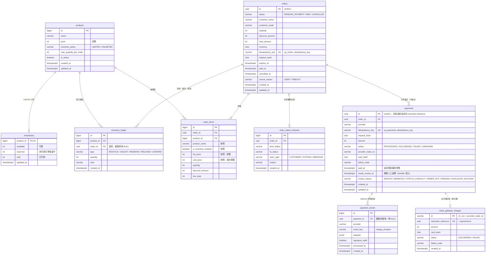
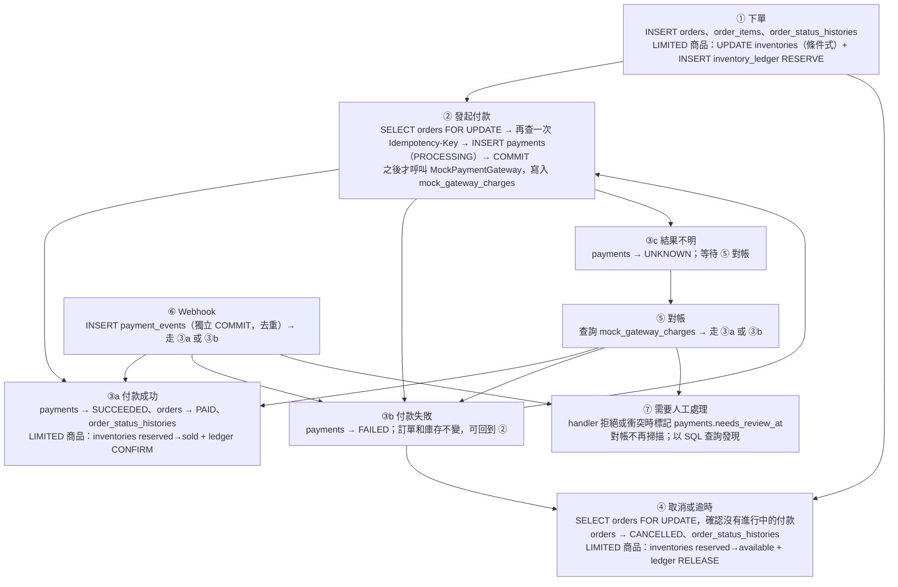

# 資料庫結構設計

> PostgreSQL 16。金額一律用整數（新台幣元）；狀態欄位用 `VARCHAR` 加上 `CHECK`（理由見 [trade-offs.md](./trade-offs.md) #17）。
> 狀態轉換規則見 [state-machines.md](./state-machines.md)，交易步驟見 [checkout-flow.md](./checkout-flow.md)。
> 本文件列出的是**業務資料表**。Laravel 預設的 migration（`users`、`password_reset_tokens`、`sessions`、`cache`、`cache_locks`、`jobs`、`job_batches`、`failed_jobs`）依使用者的決定保留（2026-10-19），但不屬於業務資料：業務表沒有外鍵參照它們，`demo:reset` 也不清除它們（[trade-offs.md](./trade-offs.md) #31）。`jobs` 表存在不代表使用 Queue，INV-01 由程式碼搜尋守住（[tasks.md](./tasks.md) T1.1）。

---

## 一、ER 圖



---

## 二、流程與資料表對照



---

## 三、商品與庫存

> migration 的建立順序和本文件的章節順序不同：`inventory_ledger.order_id` 參照 `orders`，所以要排在 `orders` 之後。順序見 [tasks.md](./tasks.md) T1.4～T1.7。

### `products`

```sql
CREATE TABLE products (
    id                     BIGSERIAL PRIMARY KEY,
    name                   VARCHAR(255) NOT NULL,
    price                  INT NOT NULL CHECK (price > 0),          -- 原價
    inventory_policy       VARCHAR(20) NOT NULL
                           CHECK (inventory_policy IN ('LIMITED', 'UNLIMITED')),
    max_quantity_per_order INT NOT NULL DEFAULT 10 CHECK (max_quantity_per_order > 0),
    is_active              BOOLEAN NOT NULL DEFAULT TRUE,
    created_at             TIMESTAMPTZ NOT NULL DEFAULT now(),
    updated_at             TIMESTAMPTZ NOT NULL DEFAULT now()
);
```

- **`inventory_policy`** 決定下單時要用哪一個 `InventoryPolicy` 實作（見 [extensibility.md](./extensibility.md)）：
  - `LIMITED`：有數量限制，例如限量周邊、實體商品，需要防超賣
  - `UNLIMITED`：沒有數量限制，例如數位商品、贊助方案，不需要庫存紀錄
- `price` 只存**原價**。未來的限時優惠價放在獨立的 `product_prices` 表，不在這裡加欄位
- `max_quantity_per_order`：限制單筆訂單的購買數量，避免一筆訂單買光所有庫存

### `inventories`：防超賣的核心

```sql
CREATE TABLE inventories (
    product_id BIGINT PRIMARY KEY REFERENCES products(id),
    available  INT NOT NULL CHECK (available >= 0),           -- 可賣
    reserved   INT NOT NULL DEFAULT 0 CHECK (reserved >= 0),  -- 未付款訂單保留中
    sold       INT NOT NULL DEFAULT 0 CHECK (sold >= 0),      -- 已付款
    updated_at TIMESTAMPTZ NOT NULL DEFAULT now()
);
```

- **只有 `LIMITED` 商品才有這一列**。這個規則由建立商品的程式（seeder、後台）保證；`UNLIMITED` 商品完全不會碰到這張表，所以不會在熱點列上產生鎖競爭
- 三個欄位分開存，並各自加上 `CHECK >= 0`。就算程式寫錯，資料庫也不允許扣成負數
- 和 `products` 分成兩張表：庫存是高頻寫入的熱點，商品資料主要被讀取。分開之後，庫存的 row lock 不會擋到讀取商品的查詢

### `inventory_ledger`：每一次庫存異動的流水帳

```sql
CREATE TABLE inventory_ledger (
    id         BIGSERIAL PRIMARY KEY,
    product_id BIGINT NOT NULL REFERENCES products(id),
    order_id   UUID REFERENCES orders(id),                    -- 進貨、盤點時為 NULL
    type       VARCHAR(20) NOT NULL
               CHECK (type IN ('RESTOCK', 'ADJUST', 'RESERVE', 'RELEASE', 'CONFIRM')),
    quantity   INT NOT NULL,
    note       VARCHAR(255),
    created_at TIMESTAMPTZ NOT NULL DEFAULT now(),
    CHECK ((type = 'ADJUST' AND quantity <> 0) OR (type <> 'ADJUST' AND quantity > 0)),
    UNIQUE (order_id, product_id, type)
);
CREATE INDEX idx_ledger_product_time ON inventory_ledger (product_id, created_at);
```

| type | available | reserved | sold | 觸發時機 |
|---|---|---|---|---|
| `RESTOCK` | + | | | 進貨（包含 seed 建立的初始庫存） |
| `ADJUST` | ±（quantity 帶正負號） | | | 盤點修正 |
| `RESERVE` | − | + | | 下單 |
| `RELEASE` | + | − | | 取消、逾時 |
| `CONFIRM` | | − | + | 付款成功 |

- **`UNIQUE (order_id, product_id, type)` 是第二道防重複的保險**。第一道是 `orders` 的狀態 CAS。就算程式出錯，讓同一張訂單執行兩次 RELEASE，第二次 INSERT 也會違反 unique key，整個 transaction 都會 rollback
- 這個 unique key 成立的前提是：**每張訂單的每一種異動最多只發生一次**。狀態機保證了這件事：`CANCELLED` 和 `PAID` 都是終止狀態，訂單不會被恢復
- PostgreSQL 的 unique 預設是 `NULLS DISTINCT`，所以 `order_id IS NULL` 的進貨紀錄可以有很多筆
- **對帳**：每個商品的 ledger 加總，必須等於 `inventories` 的三個欄位（見 [checkout-flow.md](./checkout-flow.md) §7）。seed 建立 LIMITED 商品時，也要在同一個 transaction 內寫入 `RESTOCK`，否則對帳從第一筆資料就不成立（[trade-offs.md](./trade-offs.md) #31）
- 保留中的數量可以從 ledger 推算：有 `RESERVE`、但還沒有 `CONFIRM` 或 `RELEASE` 的紀錄。所以不需要另外建一張 reservation 表（取捨見 [trade-offs.md](./trade-offs.md) #6）

---

## 四、訂單

### `orders`

```sql
CREATE TABLE orders (
    id              UUID PRIMARY KEY,                      -- UUIDv7，由應用程式產生
    status          VARCHAR(20) NOT NULL
                    CHECK (status IN ('PENDING_PAYMENT', 'PAID', 'CANCELLED')),
    customer_name   VARCHAR(100) NOT NULL,
    customer_email  VARCHAR(255) NOT NULL,
    subtotal        INT NOT NULL CHECK (subtotal >= 0),             -- 明細 line_total 的加總
    discount_amount INT NOT NULL DEFAULT 0 CHECK (discount_amount >= 0),  -- 訂單層級的折扣
    total_amount    INT NOT NULL CHECK (total_amount > 0),
    currency        CHAR(3) NOT NULL DEFAULT 'TWD',
    idempotency_key VARCHAR(64) NOT NULL,
    request_hash    CHAR(64) NOT NULL,
    expires_at      TIMESTAMPTZ NOT NULL,
    paid_at         TIMESTAMPTZ,
    cancelled_at    TIMESTAMPTZ,
    cancel_reason   VARCHAR(20) CHECK (cancel_reason IN ('USER', 'TIMEOUT')),
    created_at      TIMESTAMPTZ NOT NULL DEFAULT now(),
    updated_at      TIMESTAMPTZ NOT NULL DEFAULT now(),
    CONSTRAINT uq_orders_idempotency_key UNIQUE (idempotency_key),
    CHECK (total_amount = subtotal - discount_amount),
    CHECK ((status = 'PAID') = (paid_at IS NOT NULL)),
    CHECK ((status = 'CANCELLED') = (cancelled_at IS NOT NULL AND cancel_reason IS NOT NULL))
);
CREATE INDEX idx_orders_expire_sweep ON orders (expires_at) WHERE status = 'PENDING_PAYMENT';
```

- **`id` 用 UUIDv7**：前 48 bits 是毫秒時間戳，後面是隨機值。用時間排序時有好的 B-tree 寫入局部性，ID 也無法被猜到。系統沒有登入機制，訂單 ID 本身就是查詢訂單的憑證，所以不能用流水號（見 [trade-offs.md](./trade-offs.md) #13）
- **最後兩條 CHECK 讓狀態和時間戳記一定一致**：不可能出現「`PAID` 但沒有 `paid_at`」或「`CANCELLED` 但沒有原因」
- **`uq_orders_idempotency_key`**：同一個下單請求重送 10 次，也只會成功 INSERT 一次。**約束名稱要明確寫出**：`PlaceOrder` 只把「違反這個名稱的約束」轉成冪等重送（[checkout-flow.md](./checkout-flow.md) §八），其他 unique 違反照常拋出。inline 寫 `UNIQUE` 時 PostgreSQL 會自動命名成 `orders_idempotency_key_key`，程式和文件很容易對不上
- **`request_hash`**：請求內容（型別正規化之後）的 SHA-256。同一個 key 卻帶著不同內容時，回傳 422
- **金額欄位分三層**，為了促銷碼預留空間（見 [extensibility.md](./extensibility.md)）：
  - `order_items.line_total`：商品層級，已扣掉限時優惠價和商品層級的折扣
  - `orders.subtotal`：所有 `line_total` 的加總
  - `orders.discount_amount`：訂單層級的折扣，例如整單適用的促銷碼。目前固定為 0
- **`idx_orders_expire_sweep` 是 partial index**：只索引 `PENDING_PAYMENT` 的訂單。已完成的訂單再多，也不會讓這個索引變大
- 為什麼用 `CANCELLED` 加上 `cancel_reason`，而不是另外設一個 `EXPIRED` 狀態：見 [trade-offs.md](./trade-offs.md) #19

### `order_items`

```sql
CREATE TABLE order_items (
    id                   BIGSERIAL PRIMARY KEY,
    order_id             UUID NOT NULL REFERENCES orders(id),
    product_id           BIGINT NOT NULL REFERENCES products(id),
    product_name         VARCHAR(255) NOT NULL,                 -- 快照
    is_inventory_tracked BOOLEAN NOT NULL,                      -- 快照：下單時是否為 LIMITED
    list_price           INT NOT NULL CHECK (list_price > 0),   -- 快照：原價
    unit_price           INT NOT NULL CHECK (unit_price >= 0),  -- 快照：成交單價（未來可能是優惠價）
    quantity             INT NOT NULL CHECK (quantity > 0),
    discount_amount      INT NOT NULL DEFAULT 0 CHECK (discount_amount >= 0),  -- 商品層級的折扣
    line_total           INT NOT NULL CHECK (line_total >= 0),
    UNIQUE (order_id, product_id),
    CHECK (line_total = unit_price * quantity - discount_amount)
);
```

- **訂單和明細分開**：這次每筆訂單只有一個商品，但結構已經支援多個商品。之後要做購物車時，只需要修改前端和下單的驗證
- **價格與名稱都存快照**：訂單是一份交易紀錄，成立之後內容不應該隨著商品改價、改名而改變
- **`list_price` 和 `unit_price` 分開**：之後加上限時優惠價時，可以顯示「原價 $1,000，優惠價 $800」，不需要修改資料表
- **`is_inventory_tracked` 存快照**：取消訂單時，依照這個欄位決定要不要釋放庫存，不去看商品**目前**的設定。如果有人在訂單進行中，把商品從 `LIMITED` 改成 `UNLIMITED`，釋放庫存的行為仍然是正確的

### `order_status_histories`：訂單狀態轉換紀錄

```sql
CREATE TABLE order_status_histories (
    id          BIGSERIAL PRIMARY KEY,
    order_id    UUID NOT NULL REFERENCES orders(id),
    from_status VARCHAR(20) CHECK (from_status IN ('PENDING_PAYMENT', 'PAID', 'CANCELLED')),  -- 建立時為 NULL
    to_status   VARCHAR(20) NOT NULL CHECK (to_status IN ('PENDING_PAYMENT', 'PAID', 'CANCELLED')),
    actor_type  VARCHAR(20) NOT NULL CHECK (actor_type IN ('CUSTOMER', 'SYSTEM', 'WEBHOOK')),
    reason      VARCHAR(255),                                   -- 例如 TIMEOUT、payment=<uuid>
    created_at  TIMESTAMPTZ NOT NULL DEFAULT now()
);
CREATE INDEX idx_osh_order ON order_status_histories (order_id, created_at);
```

- **和狀態轉換寫在同一個 transaction**：只要狀態有變，就一定會有紀錄
- `orders` 上的時間戳記用來查詢；這張表用來回答「是誰、在什麼時候、因為什麼改了狀態」。例如付款成功時，要能分辨是同步回應、webhook 還是對帳讓訂單變成 `PAID`

---

## 五、金流

### `payments`：每一次付款嘗試

```sql
CREATE TABLE payments (
    id                UUID PRIMARY KEY,                    -- UUIDv7；同時是送給金流商的 merchant reference
    order_id          UUID NOT NULL REFERENCES orders(id),
    provider          VARCHAR(20) NOT NULL,                -- 'MOCK'
    idempotency_key   VARCHAR(64) NOT NULL,
    request_hash      CHAR(64) NOT NULL,
    amount            INT NOT NULL CHECK (amount > 0),
    status            VARCHAR(20) NOT NULL
                      CHECK (status IN ('PROCESSING', 'SUCCEEDED', 'FAILED', 'UNKNOWN')),
    provider_trade_no VARCHAR(64),                          -- 金流商的交易編號
    card_last4        CHAR(4),                              -- 只存末四碼
    failure_code      VARCHAR(50),
    paid_at           TIMESTAMPTZ,                          -- 金流商回報的付款時間
    needs_review_at   TIMESTAMPTZ,                          -- 需要人工處理的時間；只由 PaymentResultHandler 寫入
    review_reason     VARCHAR(30)
                      CHECK (review_reason IN ('AMOUNT_MISMATCH', 'STATUS_CONFLICT',
                                               'ORDER_NOT_PENDING', 'DUPLICATE_SUCCESS')),
    created_at        TIMESTAMPTZ NOT NULL DEFAULT now(),
    updated_at        TIMESTAMPTZ NOT NULL DEFAULT now(),
    CONSTRAINT uq_payments_idempotency_key UNIQUE (idempotency_key),
    UNIQUE (provider, provider_trade_no),
    CHECK ((status = 'SUCCEEDED') = (paid_at IS NOT NULL)),
    CHECK ((needs_review_at IS NULL) = (review_reason IS NULL))
);

-- 同一筆訂單同時只能有一筆進行中的付款
CREATE UNIQUE INDEX uq_payments_active ON payments (order_id)
    WHERE status IN ('PROCESSING', 'UNKNOWN');

-- 同一筆訂單最多只有一筆成功的付款
CREATE UNIQUE INDEX uq_payments_succeeded ON payments (order_id)
    WHERE status = 'SUCCEEDED';

-- 對帳時，只掃描還沒有結果、而且沒有標記需要人工處理的付款（條件和 checkout-flow.md §6.3 的 WHERE 相同）
CREATE INDEX idx_payments_reconcile ON payments (updated_at)
    WHERE status IN ('PROCESSING', 'UNKNOWN') AND needs_review_at IS NULL;

-- 人工處理的工作清單
CREATE INDEX idx_payments_needs_review ON payments (needs_review_at)
    WHERE needs_review_at IS NOT NULL;
```

- **orders 和 payments 是 1:N**：第一次刷卡失敗後重試，會建立新的一筆 payment。真實的金流商（例如綠界）也要求每一次交易的編號不能重複使用
- **兩個 partial unique index 把「不可以重複扣款」交給資料庫保證**。MySQL 沒有 partial index，這是選擇 PostgreSQL 的主要理由（見 [trade-offs.md](./trade-offs.md) #2）
- **`uq_payments_idempotency_key` 明確命名**：`StartPayment` 在「同一個 key 同時送到不同訂單」時靠它擋下第二筆（兩個請求鎖的是不同的訂單列，加鎖後的 key 查詢擋不住），並且只把這個名稱的違反轉成冪等重送（[checkout-flow.md](./checkout-flow.md) §4.1）。其他 UNIQUE（`(provider, provider_trade_no)`、`mock_gateway_charges.merchant_reference`）程式不會個別捕捉，沿用 PostgreSQL 的預設名稱
- **`idx_payments_reconcile` 的 partial 條件包含 `needs_review_at IS NULL`**：和對帳掃描的 WHERE 完全相同。被標記、一直停在 `PROCESSING`／`UNKNOWN` 的付款不會留在索引裡，索引只包含對帳真正要處理的列；人工清除標記之後，這一列會自動回到索引，不需要額外維護
- **`needs_review_at`、`review_reason`：需要人工處理的標記，不是狀態**。`PaymentResultHandler` 拒絕處理或發現衝突時寫入（[checkout-flow.md](./checkout-flow.md) §4.2）；最後一條 CHECK 保證兩個欄位同時有值或同時為 NULL。對帳任務跳過有標記的付款，人工用 `idx_payments_needs_review` 查詢工作清單（為什麼不是狀態、為什麼不自動終止：[trade-offs.md](./trade-offs.md) #36）

  | `review_reason` | 發生情況 | 付款狀態 |
  |---|---|---|
  | `AMOUNT_MISMATCH` | 金流回報的金額和 `payments.amount` 不一致 | 維持原狀態（`PROCESSING`／`UNKNOWN`／已終止） |
  | `STATUS_CONFLICT` | 付款已經是終止狀態，卻收到另一個終止結果（例如對帳判 `FAILED` 之後，卡住的請求拿到 `SUCCEEDED`） | 維持原本的終止狀態 |
  | `ORDER_NOT_PENDING` | 付款轉成 `SUCCEEDED`，但訂單已經不是 `PENDING_PAYMENT` | `SUCCEEDED` |
  | `DUPLICATE_SUCCESS` | 付款轉成 `SUCCEEDED` 會違反 `uq_payments_succeeded`（同一筆訂單已經有另一筆成功的付款） | 維持原狀態 |

- **不存完整卡號**：只保留末四碼，用來顯示。真實環境中，卡號由金流商的付款頁或 SDK 收集，根本不會經過我們的伺服器
- **`request_hash` 不含完整卡號**：付款的 `request_hash` 以末四碼計算，不包含 `exp`、`cvc`。完整卡號的 SHA-256 可以被暴力還原，等於間接存了卡號（[checkout-flow.md](./checkout-flow.md) §八、[trade-offs.md](./trade-offs.md) #33）
- `paid_at` 存金流商回報的時間，而不是我們收到通知的時間

### `payment_events`：webhook 原始紀錄

```sql
CREATE TABLE payment_events (
    id              BIGSERIAL PRIMARY KEY,
    payment_id      UUID REFERENCES payments(id),          -- 驗簽失敗時一律為 NULL；驗簽成功但找不到對應付款時也是 NULL
    provider        VARCHAR(20) NOT NULL,
    event_key       VARCHAR(128) NOT NULL,                 -- charge_id + ':' + status
    payload         JSONB NOT NULL,
    signature_valid BOOLEAN NOT NULL,
    processed_at    TIMESTAMPTZ,                           -- 業務處理完成才填入（規則見 checkout-flow.md §5.2）
    created_at      TIMESTAMPTZ NOT NULL DEFAULT now()
);

-- 只對驗簽成功的事件去重
CREATE UNIQUE INDEX uq_payment_events_valid ON payment_events (provider, event_key)
    WHERE signature_valid;
```

- **先存再處理**：webhook 一進來就先 INSERT 原始內容（獨立 COMMIT），再處理業務邏輯。如果處理失敗，原始資料還在，`processed_at` 仍是 NULL，重送時會再交給 handler（[checkout-flow.md](./checkout-flow.md) §5.2）
- **重送的事件會被 unique index 擋下**：既有事件已經處理完（`processed_at` 有值）時，直接回應金流商「已收到」
- **為什麼 unique index 只限 `signature_valid`**：如果驗簽失敗的事件也算進 unique，攻擊者就能先送一個簽章錯誤、但 `event_key` 相同的假事件，佔住這個 key，讓之後真正的通知被當成重複而丟掉。驗簽失敗的事件仍然要記錄下來（可能是攻擊的跡象），但不參與去重
- **驗簽失敗的事件 `payment_id` 一律是 NULL**：只有驗簽成功之後才用 `merchant_reference` 查詢 `payments`。不用未驗證的輸入查詢資料庫，也不讓偽造的事件掛在真實付款底下；它聲稱的 `merchant_reference` 仍然保存在 `payload` 裡，可以追查（[checkout-flow.md](./checkout-flow.md) §5.2）
- **`event_key` 是 `charge_id + ':' + status`**：`charge_id` 是 webhook body 的欄位名稱，值就是金流的交易編號（之後寫入 `payments.provider_trade_no`）。body 不是合法 JSON、或缺少 `charge_id`／`status` 時，`payload` 與 `event_key` 的填法見 [checkout-flow.md](./checkout-flow.md) §5.2

### `mock_gateway_charges`：模擬金流商那一端的資料

```sql
CREATE TABLE mock_gateway_charges (
    id                 VARCHAR(64) PRIMARY KEY,            -- ch_xxx，回傳給我方當作 provider_trade_no
    merchant_reference UUID NOT NULL UNIQUE,               -- = payments.id（刻意不加外鍵）
    amount             INT NOT NULL CHECK (amount > 0),
    card_last4         CHAR(4) NOT NULL,
    status             VARCHAR(20) NOT NULL CHECK (status IN ('SUCCEEDED', 'FAILED')),
    failure_code       VARCHAR(50),
    created_at         TIMESTAMPTZ NOT NULL DEFAULT now()
);
```

- 這張表代表**外部系統的資料庫**，所以刻意不和 `payments` 建立外鍵。訂單是否付款成功，以這張表為準，而不是由前端決定
- **`merchant_reference` UNIQUE 模擬金流商的冪等機制**：同一筆 payment 送出兩次扣款請求，金流端也只會有一筆紀錄，不會重複扣款
- **沒有 Eloquent model**：只有 `MockPaymentGateway`（以及 Demo 的 `mock-gateway:webhook` 指令、`demo:reset`）用 query builder（`DB::table('mock_gateway_charges')`）存取。它代表外部系統，我方的領域程式不應該有它的 model（[architecture.md](./architecture.md) §二）

---

## 六、設計重點整理

| 要防的問題 | 由哪個設計擋住 |
|---|---|
| 超賣 | `inventories` 條件式 UPDATE ＋ `CHECK (available >= 0)` |
| 重複保留、確認、釋放庫存 | `orders` 狀態 CAS ＋ `inventory_ledger` 的 unique key ＋ `CHECK (reserved >= 0)` |
| 重複下單 | `uq_orders_idempotency_key`（明確命名，程式只依這個名稱轉成冪等重送） |
| 同一個付款 key 同時送到不同訂單 | `uq_payments_idempotency_key`（兩邊鎖的是不同訂單列，只能靠資料庫擋） |
| 同一個 key 帶了不同的請求內容 | `request_hash` 比對（型別正規化之後計算） |
| 同一筆訂單同時發起兩次付款 | `uq_payments_active`（partial unique） |
| 同一筆訂單被扣款兩次 | `uq_payments_succeeded`（partial unique）＋ `mock_gateway_charges.merchant_reference` UNIQUE |
| webhook 重送 | `uq_payment_events_valid` ＋ `payments` 狀態 CAS |
| 偽造的 webhook 佔住 event key | unique index 只限 `signature_valid` |
| 偽造的 webhook 掛在真實付款底下 | 驗簽失敗的事件 `payment_id` 一律是 NULL（驗簽成功後才查詢 `payments`） |
| 竄改價格 | 價格只從 `products` 讀取，快照存在 `order_items` |
| 狀態和時間戳記不一致 | `orders`、`payments` 上的狀態一致性 CHECK |
| 需要人工處理的付款只存在 log 裡、查不到 | `payments.needs_review_at`、`review_reason` ＋ 兩者同時有值的 CHECK ＋ partial index `idx_payments_needs_review` |
| 狀態被改了卻查不到原因 | `order_status_histories`，和狀態轉換寫在同一個 transaction |
| 逾時掃描拖慢資料庫 | partial index `idx_orders_expire_sweep` |
| 對帳掃描拖慢資料庫 | partial index `idx_payments_reconcile`（只包含沒有標記的 `PROCESSING`／`UNKNOWN`） |
| 帳對不起來 | `inventory_ledger` 加總要等於 `inventories` 的三個欄位；seed 的初始庫存也寫 `RESTOCK` |
| 完整卡號被直接或間接儲存 | 只存 `card_last4`；付款的 `request_hash` 以末四碼計算（[trade-offs.md](./trade-offs.md) #33） |
