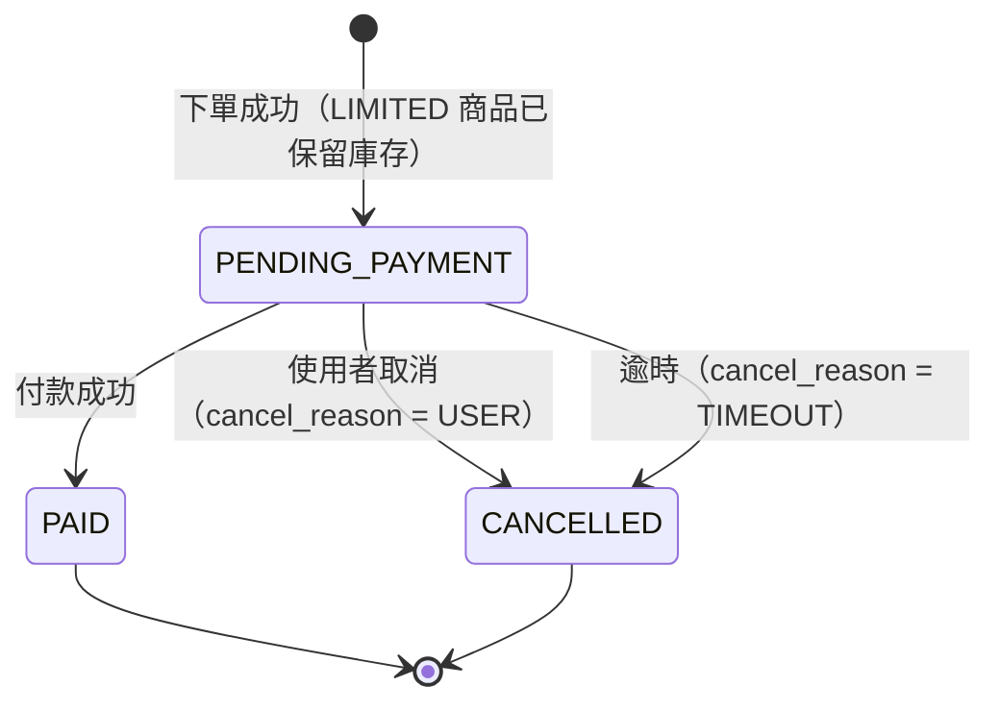
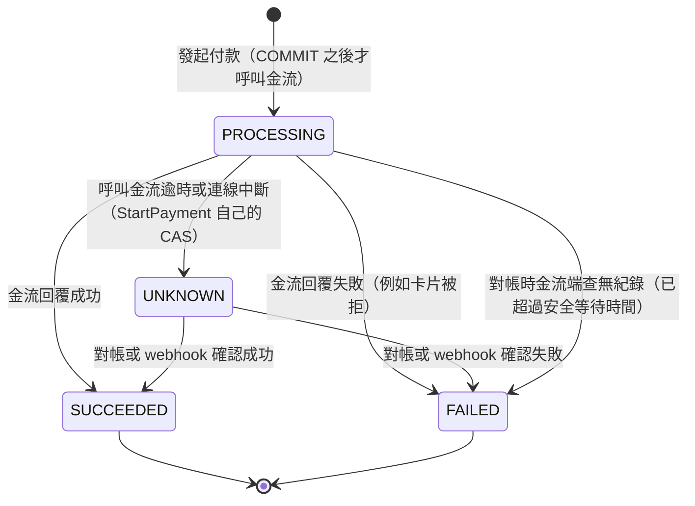
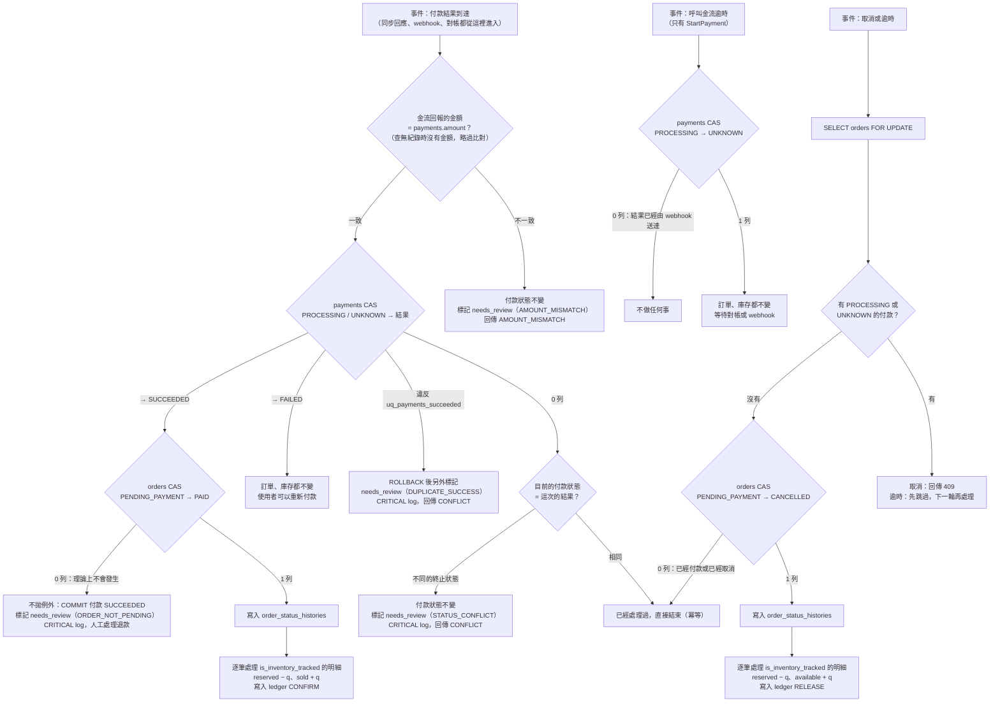
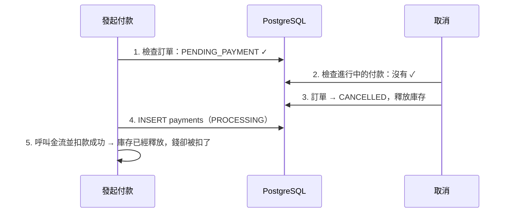

# 狀態機設計

> 資料表見 [database-schema.md](./database-schema.md)，每個操作的交易步驟見 [checkout-flow.md](./checkout-flow.md)。

## 一、設計原則

1. **一個狀態代表一組「允許的操作」**：狀態不同，代表能做的事不同。「付款失敗」並沒有改變訂單能做的事（還是可以付款、可以取消），所以它不是訂單的狀態，而是付款的狀態
2. **互相獨立的面向拆成不同的狀態機**：一筆訂單可以有多次付款嘗試，所以付款要有自己的狀態機
3. **終止狀態沒有出口**：`PAID`、`CANCELLED`、`SUCCEEDED`、`FAILED` 一旦進入，就不會再改變。這個規則也讓 `inventory_ledger` 的 unique key 能夠成立
4. **轉換規則只定義一次**：寫在 PHP enum 的 `allowedFrom()` 裡；所有轉換都用 CAS（`WHERE status IN (允許的來源狀態)`）執行

這次有兩個狀態機：**訂單**和**付款**。庫存沒有獨立的狀態機，原因見第四節。

---

## 二、訂單 `orders.status`（3 種）



| 轉換 | 前提條件 | 同一個 transaction 內的副作用 | 執行者（actor_type） |
|---|---|---|---|
| → `PENDING_PAYMENT` | LIMITED 商品的庫存足夠 | 建立明細；LIMITED 商品：`available → reserved`，寫入 ledger `RESERVE` | `CUSTOMER` |
| `PENDING_PAYMENT` → `PAID` | 有一筆付款轉成 `SUCCEEDED` | 填入 `paid_at`；LIMITED 商品：`reserved → sold`，寫入 ledger `CONFIRM` | `CUSTOMER`（同步回應）、`WEBHOOK`、`SYSTEM`（對帳） |
| `PENDING_PAYMENT` → `CANCELLED`（`USER`） | **沒有** `PROCESSING` 或 `UNKNOWN` 的付款 | 填入 `cancelled_at`；LIMITED 商品：`reserved → available`，寫入 ledger `RELEASE` | `CUSTOMER` |
| `PENDING_PAYMENT` → `CANCELLED`（`TIMEOUT`） | 已超過 `expires_at`，而且**沒有**進行中的付款 | 同上 | `SYSTEM` |

- **付款失敗不改變訂單狀態**：訂單維持 `PENDING_PAYMENT`，庫存繼續保留，使用者可以重新付款
- **保留期限不會因為重新付款而延長**：`expires_at` 在下單時就固定了（取捨見 [trade-offs.md](./trade-offs.md) #15）
- **每一次轉換**都會在同一個 transaction 內寫入 `order_status_histories`

---

## 三、付款 `payments.status`（4 種，每一次嘗試各自一個）



| 轉換 | 由誰執行 | 說明 |
|---|---|---|
| → `PROCESSING` | `StartPayment`（INSERT） | 在訂單鎖內建立，COMMIT 之後才呼叫金流（INV-07） |
| `PROCESSING` → `UNKNOWN` | `StartPayment`（`PaymentStateMachine` CAS） | **唯一不經過 `PaymentResultHandler` 的轉換**：它不是「付款結果」，而是「沒有拿到結果」，不會連動訂單與庫存 |
| `PROCESSING`／`UNKNOWN` → `SUCCEEDED`／`FAILED` | `PaymentResultHandler` | 同步回應、webhook、對帳三個入口（INV-08） |

- **一建立就是 `PROCESSING`，不另外設 `CREATED`**：在呼叫金流之前就先寫入 `PROCESSING`。萬一程式在呼叫金流前當機，這筆付款會停在 `PROCESSING`，對帳時查不到金流端的紀錄，就轉成 `FAILED`（取捨見 [trade-offs.md](./trade-offs.md) #14）
- **`UNKNOWN` 不是失敗**：錢可能已經扣了。進入終止狀態之前：
  - 不允許發起新的付款（`uq_payments_active` 擋下）
  - 不允許取消訂單，逾時任務也會跳過這筆訂單
- **「查無紀錄就轉成 `FAILED`」要等一段安全時間**：對帳只處理最後更新超過 `reconcile_safe_wait_seconds`（120 秒）的 `PROCESSING`／`UNKNOWN`。這個時間必須大於「一個付款請求最長可能存活的時間」，這個時間由兩層限制：呼叫金流的逾時（10 秒）由 `PaymentGateway` 實作的 HTTP client timeout 保證（Mock 在程序內立即回應，不會等待）；整個 HTTP 請求則由 php-fpm 的 `request_terminate_timeout`（30 秒）強制結束。啟動檢查要求 `reconcile_safe_wait_seconds ≥ 2 × request_terminate_timeout`（[trade-offs.md](./trade-offs.md) #37）。否則可能出現扣款請求還在路上、我們就已經判定失敗的情況
- **`needs_review_at` 不是狀態**：它是「需要人工處理」的標記（[database-schema.md](./database-schema.md) §五）。依第一節原則 1，**付款仍是 `PROCESSING`／`UNKNOWN` 時**，標記之後使用者能做的操作沒有改變：付款狀態仍然準確描述「我方知道的金流結果」，進行中的付款仍然擋住重付與取消（INV-09）。這個論證**只適用於 `PROCESSING`／`UNKNOWN`**：付款已經是終止狀態時（例如 `STATUS_CONFLICT` 維持 `FAILED`），`StartPayment`、`CancelOrder`、`ExpireOrder` 不讀取標記，訂單仍然可以重新付款、取消或逾時釋放，這是已知的代價（[trade-offs.md](./trade-offs.md) #36「代價」；串接真實金流時要在鎖內檢查標記，見 #36「什麼時候改」）。標記只影響**自動化流程**：對帳任務不再掃描有標記的付款。所以不新增狀態，也不修改 `allowedFrom()`、`uq_payments_active`（取捨見 [trade-offs.md](./trade-offs.md) #36）

---

## 四、為什麼庫存不需要狀態機

一筆明細的庫存狀態，完全由訂單狀態決定：

| 訂單狀態 | LIMITED 明細的庫存位置 | ledger 中已有的紀錄 |
|---|---|---|
| `PENDING_PAYMENT` | `reserved` | `RESERVE` |
| `PAID` | `sold` | `RESERVE`、`CONFIRM` |
| `CANCELLED` | 回到 `available` | `RESERVE`、`RELEASE` |

如果另外為庫存設計一個狀態機，它的狀態永遠會和訂單狀態一一對應，等於同一件事存了兩份，還要擔心兩份不一致。所以這次的做法是：

- **由訂單狀態 CAS 決定「庫存要不要動」**：只有 CAS 成功（affected rows = 1）時，才會異動庫存
- **由 `inventory_ledger` 的 `UNIQUE (order_id, product_id, type)` 當第二道保險**：就算程式出錯，同一筆訂單也不可能被 `CONFIRM` 或 `RELEASE` 兩次
- **UNLIMITED 明細（`is_inventory_tracked = false`）完全不碰庫存**

什麼時候需要加回獨立的 reservation 表：見 [trade-offs.md](./trade-offs.md) #6。

---

## 五、狀態機之間的連動



**為什麼「訂單 CAS 失敗」理論上不會發生**：付款只有在訂單是 `PENDING_PAYMENT` 時才能發起；而訂單只要還有進行中的付款，就不能被取消。這兩條規則由第六節的鎖保證。萬一真的發生（例如有人手動改了資料庫），系統也不會丟掉「錢已經扣了」這個事實：付款紀錄保持 `SUCCEEDED`，並標記需要人工處理、發出警報。

**為什麼「付款 CAS 0 列」要再讀一次目前的狀態**：0 列有兩種意思。和這次結果相同，是正常的重複送達（同步回應、webhook、對帳都到了），直接結束即可；**不同**的終止狀態則代表兩條路徑得到互相矛盾的結果，例如請求卡住超過安全等待時間、對帳判成 `FAILED(NOT_FOUND_AT_GATEWAY)`，之後卡住的請求才拿到 `SUCCEEDED`：錢扣了，我方卻記錄失敗，使用者還可以重新付款。如果把它也當成冪等，這件事就被吞掉了。終止狀態沒有出口（原則 3），所以 handler 不改狀態，而是標記並發出 CRITICAL 警報交給人工。正常情況下 php-fpm 的 `request_terminate_timeout` 讓這種情況不會發生（[trade-offs.md](./trade-offs.md) #37），這條分支是偵測，不是常態流程。

---

## 六、併發控制

| 操作 | 加鎖 | 由什麼保證正確 |
|---|---|---|
| 下單 | 不鎖訂單；`inventories` 由條件式 UPDATE 取得 row lock | 條件式 UPDATE ＋ `CHECK (available >= 0)`；`uq_orders_idempotency_key` |
| 發起付款 | `SELECT orders ... FOR UPDATE` | 鎖住後才查詢 key、檢查訂單狀態和期限；`uq_payments_active`、`uq_payments_idempotency_key` |
| 取消、逾時 | `SELECT orders ... FOR UPDATE` | 鎖住後才檢查有沒有進行中的付款；訂單狀態 CAS |
| 付款結果（三個入口） | 不另外加鎖 | `payments` CAS → `orders` CAS → ledger unique key |

**為什麼「發起付款」和「取消、逾時」必須鎖同一筆訂單**：如果不鎖，可能發生以下的交錯：



兩邊都先對同一筆訂單 `FOR UPDATE`，第 1 步和第 2 步就不會交錯：後到的一方會等前一方 COMMIT，再讀到最新的狀態。

付款結果的處理不需要鎖：它只會把訂單從 `PENDING_PAYMENT` 改成 `PAID`，而 CAS 本身就能保證只有一方成功。

---

## 七、Laravel 實作

### 1. 轉換規則：PHP enum

```php
enum OrderStatus: string
{
    case PendingPayment = 'PENDING_PAYMENT';
    case Paid = 'PAID';
    case Cancelled = 'CANCELLED';

    /** @return list<self> 可以轉換到目前這個狀態的來源狀態 */
    public function allowedFrom(): array
    {
        return match ($this) {
            self::PendingPayment => [],
            self::Paid, self::Cancelled => [self::PendingPayment],
        };
    }
}

enum PaymentStatus: string
{
    case Processing = 'PROCESSING';
    case Succeeded = 'SUCCEEDED';
    case Failed = 'FAILED';
    case Unknown = 'UNKNOWN';

    public function allowedFrom(): array
    {
        return match ($this) {
            self::Processing => [],
            self::Unknown => [self::Processing],
            self::Succeeded, self::Failed => [self::Processing, self::Unknown],
        };
    }
}

/** 需要人工處理的原因；和 payments.review_reason 的 CHECK 相同。不是 PaymentStatus */
enum ReviewReason: string
{
    case AmountMismatch = 'AMOUNT_MISMATCH';
    case StatusConflict = 'STATUS_CONFLICT';
    case OrderNotPending = 'ORDER_NOT_PENDING';
    case DuplicateSuccess = 'DUPLICATE_SUCCESS';
}
```

### 2. 轉換執行：CAS 加上歷史紀錄

```php
final class OrderStateMachine
{
    /** 必須在 DB transaction 內呼叫；回傳 false 代表已經被其他流程轉換過 */
    public function transition(
        string $orderId,
        OrderStatus $to,
        ActorType $actor,
        ?string $reason = null,
        array $attributes = [],      // 例如 paid_at、cancelled_at、cancel_reason
    ): bool {
        $from = DB::table('orders')->where('id', $orderId)->value('status');

        $affected = DB::table('orders')
            ->where('id', $orderId)
            ->whereIn('status', array_map(fn (OrderStatus $s) => $s->value, $to->allowedFrom()))
            ->update([...$attributes, 'status' => $to->value, 'updated_at' => now()]);

        if ($affected === 0) {
            return false;
        }

        OrderStatusHistory::create([
            'order_id' => $orderId,
            'from_status' => $from,
            'to_status' => $to->value,
            'actor_type' => $actor->value,
            'reason' => $reason,
        ]);

        return true;
    }
}
```

- `$from` 只是用來寫紀錄，**正確性不依賴它**：真正決定能不能轉換的是 CAS 的 `WHERE status IN (...)`
- 呼叫端依回傳值決定要不要異動庫存，這就是「訂單 CAS 決定庫存要不要動」的實作
- `PaymentStateMachine` 同樣回傳 `bool`；**「0 列時再讀目前狀態、判斷冪等或衝突」是 `PaymentResultHandler` 的責任**，不放在狀態機裡（狀態機不決定「什麼時候轉換」，見 [architecture.md](./architecture.md) §一 元件職責）

### 3. 實作重點

- 所有狀態欄位的修改，都只能透過 `OrderStateMachine` 或 `PaymentStateMachine`。不可以直接呼叫 `$order->update(['status' => ...])`
- `needs_review_at`、`review_reason` 不是狀態欄位，只由 `PaymentResultHandler` 寫入，而且只會從 NULL 變成有值（`COALESCE`，保留第一次的原因）
- 新增狀態時，只需要修改 enum 和 migration 的 `CHECK`，CAS 和歷史紀錄的程式都不用動
